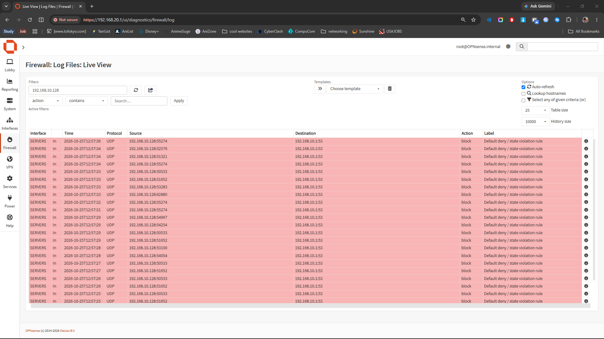
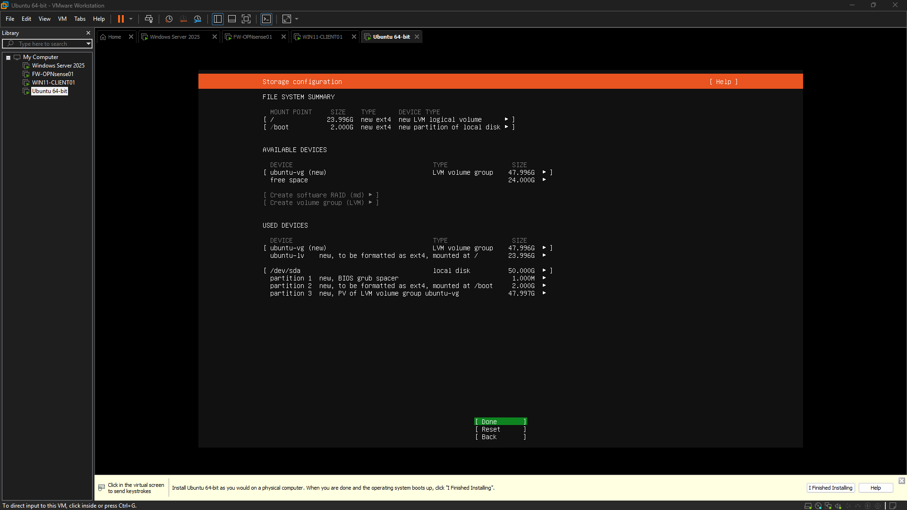
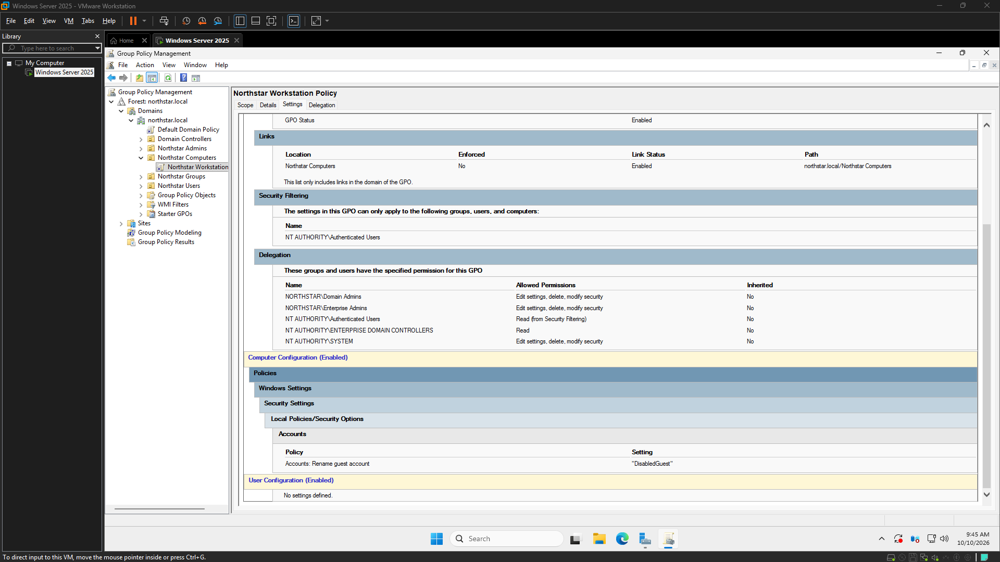

# Roadmap

Starting from the fundamentals, building progressively, and following curiosity wherever it leads. A living record of projects, experiments, lessons learned, and the journey from beginner to builder.

## Gallery

<!-- autodoc:project:networking-infrastructure-engineering:start -->
### [Networking & Infrastructure Engineering](projects/networking-infrastructure-engineering/README.md)

**Complete** · [Source repository](https://github.com/harkdev1/networking-infrastructure-engineering)

This project established a foundational network infrastructure using OPNsense, demonstrating core routing, firewalling, and network services for a multi-segment environment. It validated critical client connectivity and advanced firewall enforcement, while also highlighting key learnings in network state management. --- ### 1. Project story This project focused on engineering a robust and segmented network...

<!-- autodoc:project:networking-infrastructure-engineering:end -->

<!-- autodoc:project:project:start -->
### [Project](projects/project/README.md)

**In progress** · [Source repository](https://github.com/harkdev1/networking-infrastructure-engineering)

Created the Networking & Infrastructure Engineering project workspace, initialized AutoDoc, installed GitHub CLI and authenticated with GitHub, created the public networking-infrastructure-engineering repository, configured the origin remote and main branch, pushed the initial AutoDoc project structure, enabled automatic synchronization, generated the first engineering log and committed the initial documentation...
<!-- autodoc:project:project:end -->

<!-- autodoc:project:cyberops-sandbox:start -->
### [CyberOps Sandbox](projects/cyberops-sandbox/README.md)

**Main Homelab · In progress** · [Source repository](https://github.com/harkdev1/CyberOps-Sandbox)

Reviewed Ubuntu 26.04.1 compatibility with the Wazuh deployment, verified the Wazuh signing key, identified Ubuntu Server 24.04 LTS as the documented installation target, obtained the Ubuntu Server 24.04.5 ISO, prepared the existing virtual machine for OS replacement.

<!-- autodoc:project:cyberops-sandbox:end -->

<!-- autodoc:project:windows-helpdesk-lab:start -->
### [Windows Helpdesk Lab](projects/windows-helpdesk-lab/README.md)

**Complete (v1.0)** · [CyberOps archive](https://github.com/harkdev1/CyberOps-Sandbox/tree/main/projects/windows-helpdesk-lab)

A small-business-style Windows domain lab using the Northstar environment. The completed foundation covers NS-DC01, Active Directory and DNS, directory/group checks, and reusable PowerShell diagnostics. The Northstar Workstation Policy is configured and linked, but its application to a domain-joined workstation is unverified. Account access, DNS/connectivity, and policy-behavior ticket exercises remain proposed...

<!-- autodoc:project:windows-helpdesk-lab:end -->

## How the gallery updates

`autodoc finish` refreshes the current project's showcase, and `autodoc project complete` updates it with the completed status. AutoDoc selects screenshots referenced in that project's logs, filters known private captures, asks once before publishing new images, verifies each copied image, and links it to its source GitHub log. Previously approved images are reverified and reused automatically. It pushes only the project's gallery folder and this index. Use `--skip-roadmap` to opt out or `--roadmap-dir` to select the gallery location.

Source code and full session logs stay in their project repositories. Roadmap is the visual showcase, not a second copy of project implementations.
