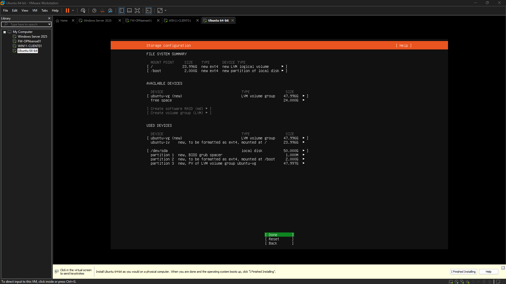
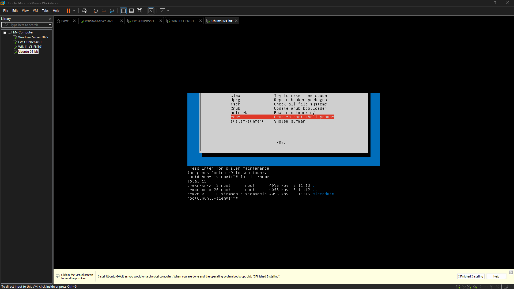
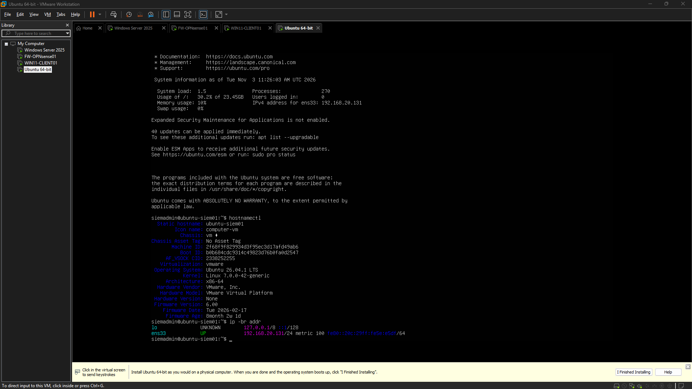
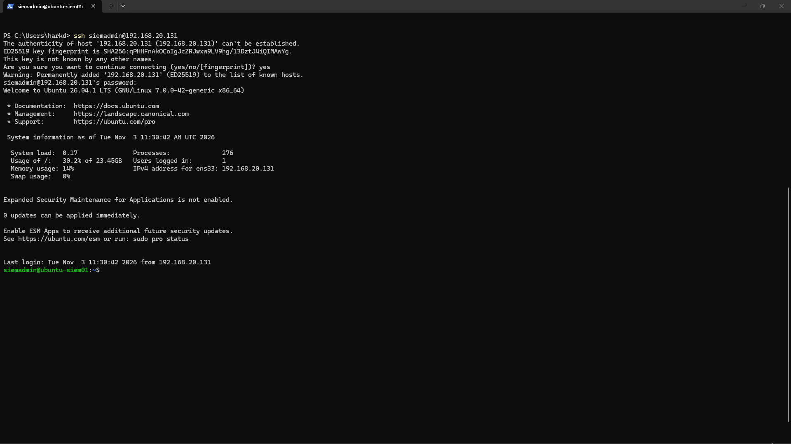
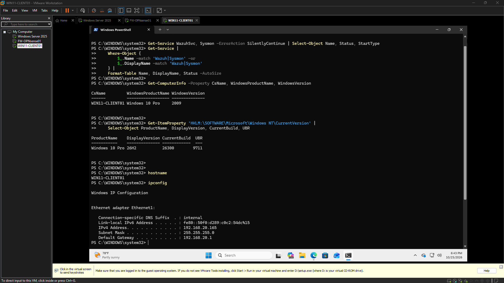
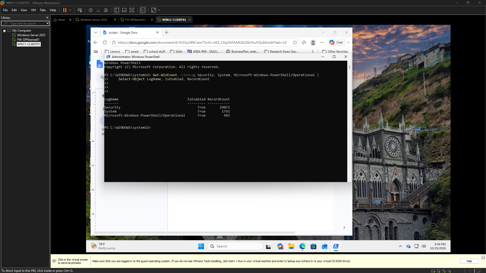
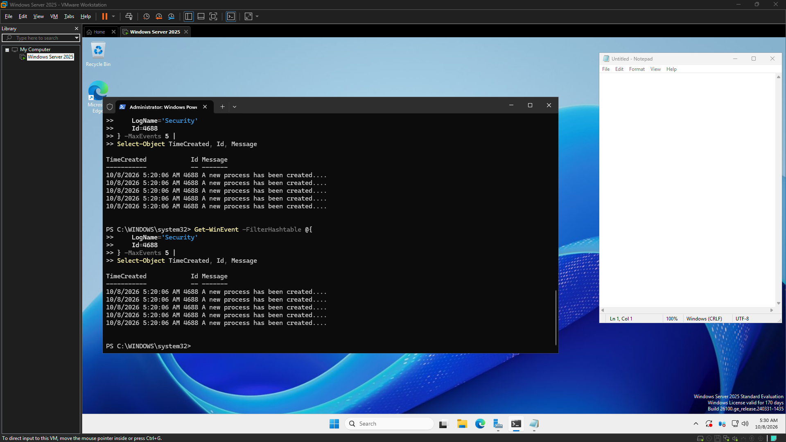
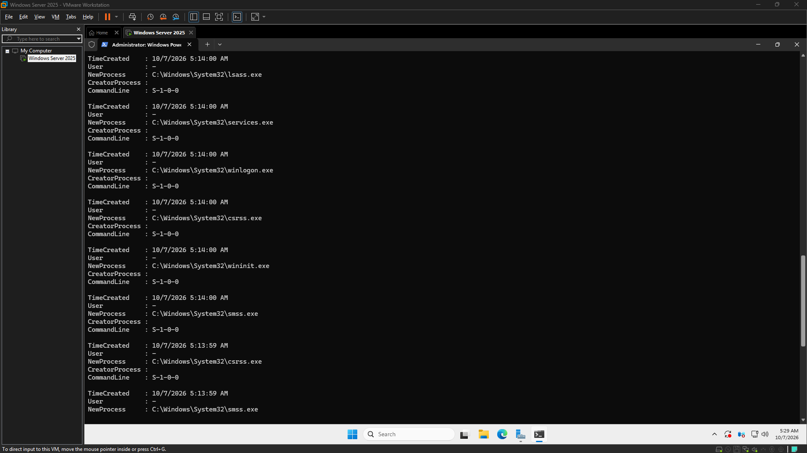
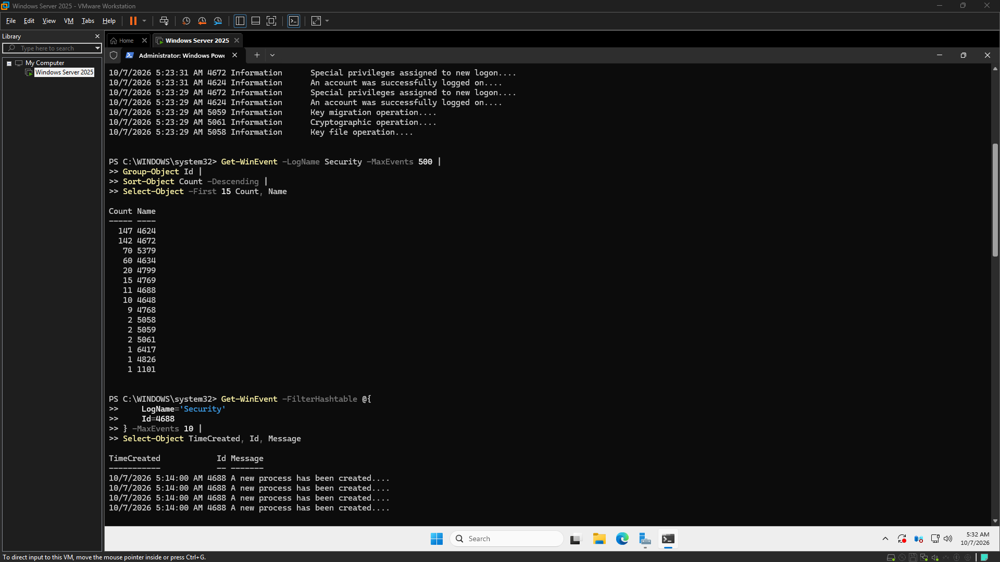
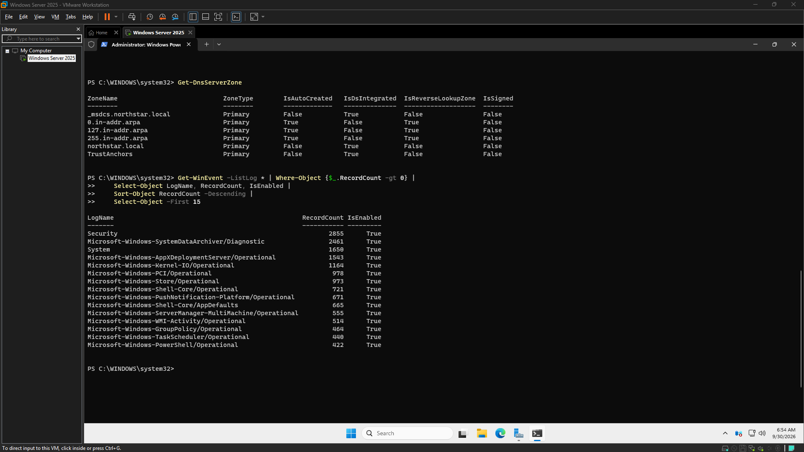

# CyberOps Sandbox

**Main Homelab · In progress** · [Source repository](https://github.com/harkdev1/CyberOps-Sandbox)

A hands-on Windows security homelab built through controlled experiments. The current work studies what Windows Security telemetry actually records, using PowerShell and event logs to validate evidence rather than assume a detection succeeded.

The latest recorded test found that the configured Security log did not reliably expose the process/file activity under investigation. That visibility gap is a finding, not a completed detection capability. The next step is to review audit policy configuration and repeat the controlled tests.

## Showcase

<!-- autodoc:project-showcase:start -->
**Main Homelab · Status:** In progress
**Source repository:** [https://github.com/harkdev1/CyberOps-Sandbox](https://github.com/harkdev1/CyberOps-Sandbox)

## What I built
Reviewed Ubuntu 26.04.1 compatibility with the Wazuh deployment, verified the Wazuh signing key, identified Ubuntu Server 24.04 LTS as the documented installation target, obtained the Ubuntu Server 24.04.5 ISO, prepared the existing virtual machine for OS replacement.

## Evidence gallery
### Ubuntu Storage Configuration

Evidence copied from [logs/2026-11-03.md](https://github.com/harkdev1/CyberOps-Sandbox/blob/main/logs/2026-11-03.md) and verified against the source image.

### Ubuntu Username Recovery after forgetting

Evidence copied from [logs/2026-11-03.md](https://github.com/harkdev1/CyberOps-Sandbox/blob/main/logs/2026-11-03.md) and verified against the source image.

### Ubuntu Server First Login

Evidence copied from [logs/2026-11-03.md](https://github.com/harkdev1/CyberOps-Sandbox/blob/main/logs/2026-11-03.md) and verified against the source image.

### Ubuntu SSH Service Running

Evidence copied from [logs/2026-11-03.md](https://github.com/harkdev1/CyberOps-Sandbox/blob/main/logs/2026-11-03.md) and verified against the source image.

### Endpoint Baseline Initial Audit

Evidence copied from [logs/2026-10-25.md](https://github.com/harkdev1/CyberOps-Sandbox/blob/main/logs/2026-10-25.md) and verified against the source image.

### Security Log Baseline

Evidence copied from [logs/2026-10-25.md](https://github.com/harkdev1/CyberOps-Sandbox/blob/main/logs/2026-10-25.md) and verified against the source image.

### Telemetry Visibility Gap

Evidence copied from [logs/2026-10-08.md](https://github.com/harkdev1/CyberOps-Sandbox/blob/main/logs/2026-10-08.md) and verified against the source image.

### Process Creation Telemetry

Evidence copied from [logs/2026-10-07.md](https://github.com/harkdev1/CyberOps-Sandbox/blob/main/logs/2026-10-07.md) and verified against the source image.

### Security Event Distribution

Evidence copied from [logs/2026-10-07.md](https://github.com/harkdev1/CyberOps-Sandbox/blob/main/logs/2026-10-07.md) and verified against the source image.

### CyberOps Baseline v0.1

Evidence copied from [logs/2026-09-30.md](https://github.com/harkdev1/CyberOps-Sandbox/blob/main/logs/2026-09-30.md) and verified against the source image.

## Session highlights

### 2026-11-04 · 05:49 to 06:19
Recorded outcome: ❌ No. Reviewed Ubuntu 26.04.1 compatibility with the Wazuh deployment, verified the Wazuh signing key, identified Ubuntu Server 24.04 LTS as the documented installation target, obtained the Ubuntu Server 24.04.5 ISO, prepared the existing virtual machine for OS replacement.
[Open the original AutoDoc log](https://github.com/harkdev1/CyberOps-Sandbox/blob/main/logs/2026-11-04.md)

### 2026-11-03 · 05:57 to 06:34
Recorded outcome: ✅ Yes. A dedicated Ubuntu Server 26.04.1 LTS virtual machine has been successfully provisioned in VMware, establishing a foundational Linux server for centralized security monitoring. The VM was integrated into the existing segmented OPNsense LAN, with core system configuration, network validation, and remote administration capabilities established. This prepares the environment for future Wazuh deployment without requiring a rebuild of existing infrastructure.
[Open the original AutoDoc log](https://github.com/harkdev1/CyberOps-Sandbox/blob/main/logs/2026-11-03.md)

### 2026-10-26 · 05:52 to 06:38
Recorded outcome: ✅ Yes. Significant progress was made in establishing foundational infrastructure and planning for the development of security operations capabilities. Key activities included reviewing existing network infrastructure, confirming baseline checks, establishing remaining Month 1 tasks, and planning for Wazuh deployment. The primary constraint identified is limited host memory, which requires further evaluation before proceeding with new installations.
[Open the original AutoDoc log](https://github.com/harkdev1/CyberOps-Sandbox/blob/main/logs/2026-10-26.md)

### 2026-10-25 · 18:32 to 18:48
Recorded outcome: ✅ Yes. Initial validation of the existing lab infrastructure was performed to establish an evidence-based starting point for the November CyberOps SIEM and detection engineering work. This involved reviewing network baselines, verifying endpoint network identity and connectivity, and confirming the status of core Windows event logging sources on a target workstation. A key finding was the absence of dedicated endpoint telemetry agents, identifying telemetry collection as the next critical technical milestone. No system or network configuration changes were made, preserving the existing infrastructure.
[Open the original AutoDoc log](https://github.com/harkdev1/CyberOps-Sandbox/blob/main/logs/2026-10-25.md)

### 2026-10-11 · 10:55 to 11:07
Recorded outcome: ✅ Yes. Current efforts focused on establishing a verified baseline configuration for NS-DC01, documenting its existing state, and identifying reusable administrative assets from Project 1. This foundational work is crucial for preparing the environment for Project 2, with a strong emphasis on preserving current capabilities and avoiding premature changes.
[Open the original AutoDoc log](https://github.com/harkdev1/CyberOps-Sandbox/blob/main/logs/2026-10-11.md)

### 2026-10-08 · 05:19 to 05:30
Recorded outcome: ✅ Yes. An initial experimental session was conducted within the CyberOps Sandbox on NS-DC01 to evaluate the reliability of existing Windows Security telemetry in observing intentional, simple process and file activities. The session established that the current Security log configuration does not reliably expose the tested activities, identifying significant visibility gaps. This work underscores a hands-on, experimental methodology focused on understanding and improving telemetry from the ground up, treating failures to observe expected activity as critical engineering findings.
[Open the original AutoDoc log](https://github.com/harkdev1/CyberOps-Sandbox/blob/main/logs/2026-10-08.md)

### 2026-10-07 · 05:12 to 05:17
Recorded outcome: ❌ No. The previous work session has been deemed unsatisfactory and requires a complete re-execution. No tasks from this session can be considered successfully completed at this time.
[Open the original AutoDoc log](https://github.com/harkdev1/CyberOps-Sandbox/blob/main/logs/2026-10-07.md)

### 2026-09-30 · 06:46 to 06:55
Recorded outcome: ✅ Yes. Initial project baselining activities have been completed, with key specifications documented.
[Open the original AutoDoc log](https://github.com/harkdev1/CyberOps-Sandbox/blob/main/logs/2026-09-30.md)

## Current limitations and next steps
Ubuntu Server 24.04.5 ISO selected and attached for reinstallation. Final boot/install confirmation and OS compatibility validation remain outstanding. Wazuh repository and packages have not yet been installed.

## Project files
- [Current project status](https://github.com/harkdev1/CyberOps-Sandbox/blob/main/project-status.md)
- [Short project summary](https://github.com/harkdev1/CyberOps-Sandbox/blob/main/docs/project-complete-short.md)
- [Full project history](https://github.com/harkdev1/CyberOps-Sandbox/blob/main/docs/project-complete-long.md)
- [Evidence index](evidence-index.md)

---
Screenshots are copied only from image references present in AutoDoc logs. Review each image for private details before publishing.
Gallery folder: `projects/cyberops-sandbox/screenshots/`.
<!-- autodoc:project-showcase:end -->

AutoDoc adds images referenced by the project's logs and session highlights here after a successful `autodoc finish` or `autodoc project complete` sync.
