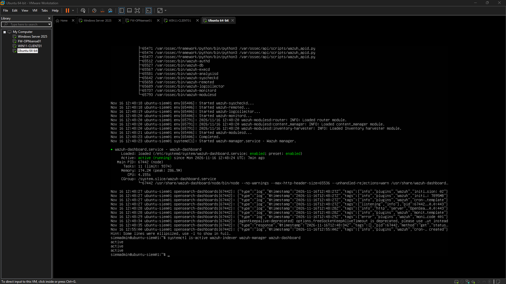
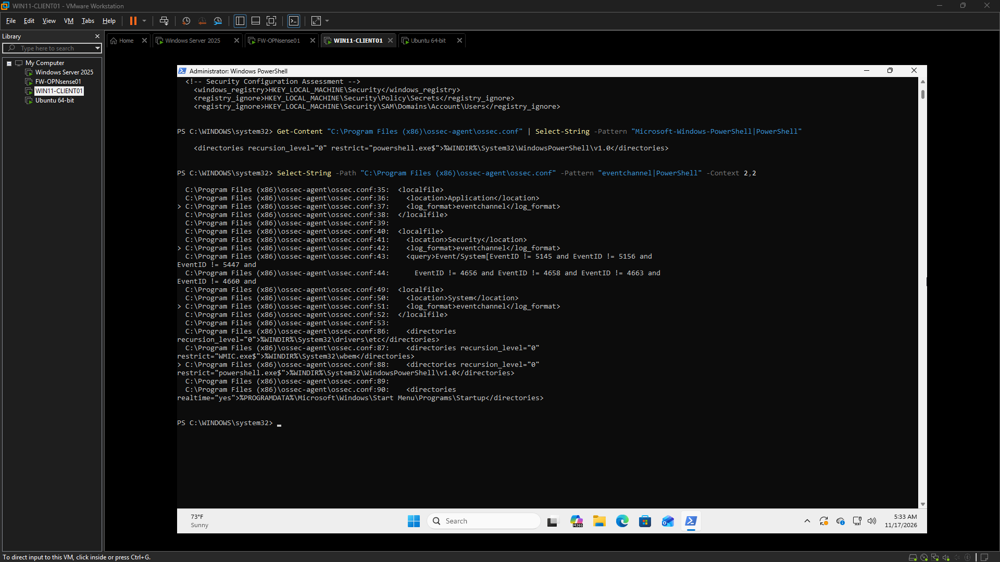
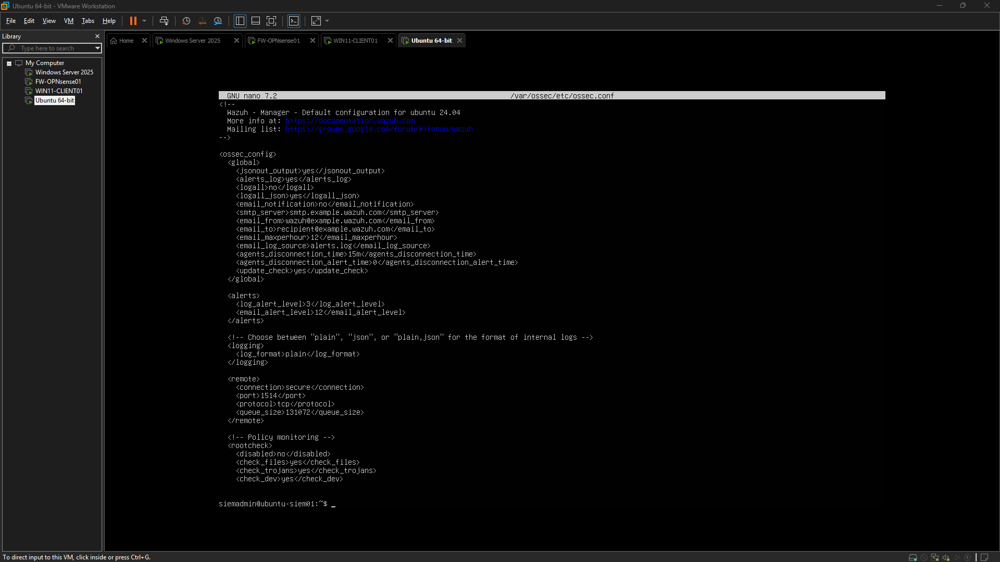
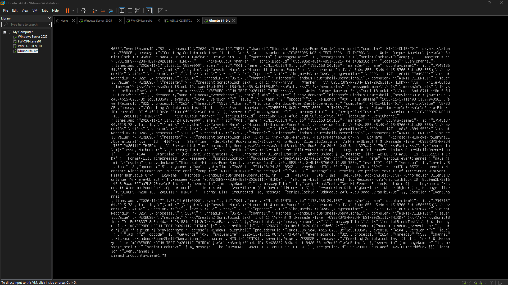

# CyberOps Sandbox

**Main Homelab · In progress** · [Source repository](https://github.com/harkdev1/CyberOps-Sandbox)

A hands-on Windows security homelab built through controlled experiments. The current work studies what Windows Security telemetry actually records, using PowerShell and event logs to validate evidence rather than assume a detection succeeded.

The latest recorded test found that the configured Security log did not reliably expose the process/file activity under investigation. That visibility gap is a finding, not a completed detection capability. The next step is to review audit policy configuration and repeat the controlled tests.

## Showcase

<!-- autodoc:project-showcase:start -->
**Main Homelab · Status:** In progress
**Source repository:** [https://github.com/harkdev1/CyberOps-Sandbox](https://github.com/harkdev1/CyberOps-Sandbox)

## What I built
Configured Windows PowerShell Script Block Logging through the Windows registry, verified local generation of PowerShell Event ID 4104, confirmed the Wazuh agent was collecting the PowerShell Operational event channel, enabled Wazuh JSON event archiving, corrected the Wazuh manager configuration XML and validated it, restarted the Wazuh manager successfully, verified that controlled PowerShell test events reached ubuntu-siem01 and were written to /var/ossec/logs/archives/archives.json.

**Summary:**
Successfully implemented and validated end-to-end collection of Windows PowerShell Event ID 4104 (Script Block Logging) telemetry. This involved enabling script-block auditing on a Windows endpoint via the registry, configuring the Wazuh agent to collect these events, and setting up the Wazuh manager to retain raw JSON events in its archives. Key issues encountered during configuration, including incorrect manager XML and policy activation nuances, were identified and resolved, culminating in the successful verification of controlled PowerShell events reaching the centralized SIEM and being stored in JSON format.

**Tasks Completed:**
*   Configured Windows PowerShell Script Block Logging through the Windows registry.
*   Verified local generation of PowerShell Event ID 4104 on the Windows endpoint.
*   Confirmed the Wazuh agent was successfully collecting the PowerShell Operational event channel.
*   Enabled Wazuh JSON event archiving on the manager.
*   Corrected the Wazuh manager configuration XML to enable archiving.
*   Validated the corrected Wazuh manager configuration.
*   Successfully restarted the Wazuh manager service.
*   Verified that controlled PowerShell test events reached the `ubuntu-siem01` Wazuh manager.
*   Confirmed that these events were written to `/var/ossec/logs/archives/archives.json`.

**Issues Encountered:**
*   **Wazuh Event Visibility:** PowerShell events were initially visible locally on the Windows endpoint but were not appearing in Wazuh, suggesting a collection or forwarding issue.
*   **Script Block Logging Activation:** Script Block Logging was not enabled through the initially expected registry policy, requiring a specific registry key modification.
*   **PowerShell Session Refresh:** After enabling the Script Block Logging policy, a fresh PowerShell process was required before controlled events would appear, a detail initially overlooked.
*   **Wazuh Manager Configuration Errors:** The Wazuh manager configuration XML contained duplicate root elements, which prevented JSON archiving from being enabled successfully until corrected.
*   **Troubleshooting Focus:** Initial troubleshooting efforts were misdirected, focusing too heavily on Wazuh agent collection and manager forwarding before adequately confirming the Windows endpoint was generating the specific controlled PowerShell events.

**Next Steps:**
No further next steps were outlined for this specific implementation and validation phase.

**Notes:**
*   A key lesson learned during troubleshooting was the critical importance of verifying local event generation on the source endpoint *before* investigating collection or forwarding issues with the SIEM agent.
*   The correct sequence for verifying end-to-end telemetry was established: enable logging, generate a controlled event, verify the event locally on the source, then verify its presence in the manager's archives.
*   Careful attention must be paid to PowerShell policy activation, as some changes (like Script Block Logging via registry) require opening a fresh PowerShell process to take effect.

## Evidence gallery
### Wazuh Services Operational

Evidence copied from [logs/2026-11-16.md](https://github.com/harkdev1/CyberOps-Sandbox/blob/main/logs/2026-11-16.md) and verified against the source image.

### Wazuh Dashboard Accessible

Evidence copied from [logs/2026-11-16.md](https://github.com/harkdev1/CyberOps-Sandbox/blob/main/logs/2026-11-16.md) and verified against the source image.

### Ubuntu Storage Configuration

Evidence copied from [logs/2026-11-03.md](https://github.com/harkdev1/CyberOps-Sandbox/blob/main/logs/2026-11-03.md) and verified against the source image.

### Ubuntu Username Recovery after forgetting

Evidence copied from [logs/2026-11-03.md](https://github.com/harkdev1/CyberOps-Sandbox/blob/main/logs/2026-11-03.md) and verified against the source image.

### Ubuntu Server First Login

Evidence copied from [logs/2026-11-03.md](https://github.com/harkdev1/CyberOps-Sandbox/blob/main/logs/2026-11-03.md) and verified against the source image.

### Ubuntu SSH Service Running

Evidence copied from [logs/2026-11-03.md](https://github.com/harkdev1/CyberOps-Sandbox/blob/main/logs/2026-11-03.md) and verified against the source image.

### Endpoint Baseline Initial Audit

Evidence copied from [logs/2026-10-25.md](https://github.com/harkdev1/CyberOps-Sandbox/blob/main/logs/2026-10-25.md) and verified against the source image.

### Security Log Baseline

Evidence copied from [logs/2026-10-25.md](https://github.com/harkdev1/CyberOps-Sandbox/blob/main/logs/2026-10-25.md) and verified against the source image.

### Telemetry Visibility Gap

Evidence copied from [logs/2026-10-08.md](https://github.com/harkdev1/CyberOps-Sandbox/blob/main/logs/2026-10-08.md) and verified against the source image.

### Process Creation Telemetry

Evidence copied from [logs/2026-10-07.md](https://github.com/harkdev1/CyberOps-Sandbox/blob/main/logs/2026-10-07.md) and verified against the source image.

### Security Event Distribution

Evidence copied from [logs/2026-10-07.md](https://github.com/harkdev1/CyberOps-Sandbox/blob/main/logs/2026-10-07.md) and verified against the source image.

### CyberOps Baseline v0.1

Evidence copied from [logs/2026-09-30.md](https://github.com/harkdev1/CyberOps-Sandbox/blob/main/logs/2026-09-30.md) and verified against the source image.

### Wazuh Agent Installed/Started Successfully

Evidence copied from [logs/2026-11-17.md](https://github.com/harkdev1/CyberOps-Sandbox/blob/main/logs/2026-11-17.md) and verified against the source image.

### Wazuh Powershell Configuration

Evidence copied from [logs/2026-11-17.md](https://github.com/harkdev1/CyberOps-Sandbox/blob/main/logs/2026-11-17.md) and verified against the source image.

### Wazuh Windows Endpoint Investigation

Evidence copied from [logs/2026-11-17.md](https://github.com/harkdev1/CyberOps-Sandbox/blob/main/logs/2026-11-17.md) and verified against the source image.

### Raw Event Archiving Configuration

Evidence copied from [logs/2026-11-17.md](https://github.com/harkdev1/CyberOps-Sandbox/blob/main/logs/2026-11-17.md) and verified against the source image.

### Wazuh Powershell Event Ingestion Confirmed

Evidence copied from [logs/2026-11-17.md](https://github.com/harkdev1/CyberOps-Sandbox/blob/main/logs/2026-11-17.md) and verified against the source image.

## Session highlights

### 2026-11-17 · 05:05 to 06:11
Recorded outcome: ✅ Yes. Successful implementation and validation of end-to-end Windows PowerShell telemetry collection, enabling script-block auditing on the endpoint, configuring Wazuh to retain raw JSON events, troubleshooting and correcting the manager configuration, proving that controlled Event ID 4104 records traveled from the Windows endpoint to the centralized SIEM.
[Open the original AutoDoc log](https://github.com/harkdev1/CyberOps-Sandbox/blob/main/logs/2026-11-17.md)

### 2026-11-16 · 07:12 to 08:01
Recorded outcome: ✅ Yes. Establishing a compatible SIEM server environment, rebuilding the Ubuntu infrastructure while preserving VMware hardware configuration, configuring secure remote administration, deploying and recovering a centralized security monitoring stack, validating service health and dashboard accessibility, overcoming infrastructure resource constraints.
[Open the original AutoDoc log](https://github.com/harkdev1/CyberOps-Sandbox/blob/main/logs/2026-11-16.md)

### 2026-11-04 · 05:49 to 06:19
Recorded outcome: ❌ No. Reviewed Ubuntu 26.04.1 compatibility with the Wazuh deployment, verified the Wazuh signing key, identified Ubuntu Server 24.04 LTS as the documented installation target, obtained the Ubuntu Server 24.04.5 ISO, prepared the existing virtual machine for OS replacement.
[Open the original AutoDoc log](https://github.com/harkdev1/CyberOps-Sandbox/blob/main/logs/2026-11-04.md)

### 2026-11-03 · 05:57 to 06:34
Recorded outcome: ✅ Yes. A dedicated Ubuntu Server 26.04.1 LTS virtual machine has been successfully provisioned in VMware, establishing a foundational Linux server for centralized security monitoring. The VM was integrated into the existing segmented OPNsense LAN, with core system configuration, network validation, and remote administration capabilities established. This prepares the environment for future Wazuh deployment without requiring a rebuild of existing infrastructure.
[Open the original AutoDoc log](https://github.com/harkdev1/CyberOps-Sandbox/blob/main/logs/2026-11-03.md)

### 2026-10-26 · 05:52 to 06:38
Recorded outcome: ✅ Yes. Significant progress was made in establishing foundational infrastructure and planning for the development of security operations capabilities. Key activities included reviewing existing network infrastructure, confirming baseline checks, establishing remaining Month 1 tasks, and planning for Wazuh deployment. The primary constraint identified is limited host memory, which requires further evaluation before proceeding with new installations.
[Open the original AutoDoc log](https://github.com/harkdev1/CyberOps-Sandbox/blob/main/logs/2026-10-26.md)

### 2026-10-25 · 18:32 to 18:48
Recorded outcome: ✅ Yes. Initial validation of the existing lab infrastructure was performed to establish an evidence-based starting point for the November CyberOps SIEM and detection engineering work. This involved reviewing network baselines, verifying endpoint network identity and connectivity, and confirming the status of core Windows event logging sources on a target workstation. A key finding was the absence of dedicated endpoint telemetry agents, identifying telemetry collection as the next critical technical milestone. No system or network configuration changes were made, preserving the existing infrastructure.
[Open the original AutoDoc log](https://github.com/harkdev1/CyberOps-Sandbox/blob/main/logs/2026-10-25.md)

### 2026-10-11 · 10:55 to 11:07
Recorded outcome: ✅ Yes. Current efforts focused on establishing a verified baseline configuration for NS-DC01, documenting its existing state, and identifying reusable administrative assets from Project 1. This foundational work is crucial for preparing the environment for Project 2, with a strong emphasis on preserving current capabilities and avoiding premature changes.
[Open the original AutoDoc log](https://github.com/harkdev1/CyberOps-Sandbox/blob/main/logs/2026-10-11.md)

### 2026-10-08 · 05:19 to 05:30
Recorded outcome: ✅ Yes. An initial experimental session was conducted within the CyberOps Sandbox on NS-DC01 to evaluate the reliability of existing Windows Security telemetry in observing intentional, simple process and file activities. The session established that the current Security log configuration does not reliably expose the tested activities, identifying significant visibility gaps. This work underscores a hands-on, experimental methodology focused on understanding and improving telemetry from the ground up, treating failures to observe expected activity as critical engineering findings.
[Open the original AutoDoc log](https://github.com/harkdev1/CyberOps-Sandbox/blob/main/logs/2026-10-08.md)

### 2026-10-07 · 05:12 to 05:17
Recorded outcome: ❌ No. The previous work session has been deemed unsatisfactory and requires a complete re-execution. No tasks from this session can be considered successfully completed at this time.
[Open the original AutoDoc log](https://github.com/harkdev1/CyberOps-Sandbox/blob/main/logs/2026-10-07.md)

### 2026-09-30 · 06:46 to 06:55
Recorded outcome: ✅ Yes. Initial project baselining activities have been completed, with key specifications documented.
[Open the original AutoDoc log](https://github.com/harkdev1/CyberOps-Sandbox/blob/main/logs/2026-09-30.md)

## Current limitations and next steps
The next session should begin by verifying that PowerShell Event ID 4104 records are searchable in the Wazuh Dashboard, then proceed to detection engineering and controlled detection testing.

## Project files
- [Current project status](https://github.com/harkdev1/CyberOps-Sandbox/blob/main/project-status.md)
- [Short project summary](https://github.com/harkdev1/CyberOps-Sandbox/blob/main/docs/project-complete-short.md)
- [Full project history](https://github.com/harkdev1/CyberOps-Sandbox/blob/main/docs/project-complete-long.md)
- [Evidence index](evidence-index.md)

---
Screenshots are copied only from image references present in AutoDoc logs. Review each image for private details before publishing.
Gallery folder: `projects/cyberops-sandbox/screenshots/`.
<!-- autodoc:project-showcase:end -->

AutoDoc adds images referenced by the project's logs and session highlights here after a successful `autodoc finish` or `autodoc project complete` sync.
