# CyberOps Sandbox

**Main Homelab · In progress** · [Source repository](https://github.com/harkdev1/CyberOps-Sandbox)

A hands-on Windows security homelab built through controlled experiments. The current work studies what Windows Security telemetry actually records, using PowerShell and event logs to validate evidence rather than assume a detection succeeded.

The latest recorded test found that the configured Security log did not reliably expose the process/file activity under investigation. That visibility gap is a finding, not a completed detection capability. The next step is to review audit policy configuration and repeat the controlled tests.

## Showcase

<!-- autodoc:project-showcase:start -->
**Main Homelab · Status:** In progress
**Source repository:** [https://github.com/harkdev1/CyberOps-Sandbox](https://github.com/harkdev1/CyberOps-Sandbox)

## What I built
Inspected PowerShell Event ID 4104 records in Wazuh Threat Hunting, examined event JSON and script-block contents, identified security-policy discovery activity using secedit and PasswordHistorySize, enabled Filebeat Wazuh archive forwarding, validated the Filebeat configuration, restarted Filebeat successfully, generated controlled Get-LocalUser activity on WIN11-CLIENT01, verified the resulting Event ID 4104 records locally, confirmed the events reached /var/ossec/logs/archives/archives.json.

**Summary:**
This documentation outlines the successful establishment and validation of centralized PowerShell Script Block Logging telemetry within Wazuh. Key activities included enabling and configuring Filebeat archive forwarding, inspecting raw PowerShell Event ID 4104 records, identifying security policy discovery activity, and validating controlled endpoint actions against raw SIEM archives. The work specifically focused on distinguishing successful event ingestion from dashboard indexing limitations, thereby laying a critical foundation for subsequent detection engineering efforts.

**Tasks Completed:**
*   Inspected existing PowerShell Event ID 4104 records within Wazuh Threat Hunting.
*   Examined event JSON and script-block contents to understand current telemetry.
*   Identified security-policy discovery activity using `secedit` and `PasswordHistorySize` commands.
*   Enabled Filebeat Wazuh archive forwarding to ensure all raw events are stored.
*   Validated the Filebeat configuration for correctness.
*   Successfully restarted the Filebeat service.
*   Generated controlled `Get-LocalUser` activity on the designated endpoint, WIN11-CLIENT01, to create new events.
*   Verified the resulting Event ID 4104 records locally on WIN11-CLIENT01.
*   Confirmed that the generated events successfully reached `/var/ossec/logs/archives/archives.json` on the Wazuh manager.

**Issues Encountered:**
*   Difficulty in distinguishing between successful raw event ingestion into archives and their subsequent indexing for dashboard visibility.
*   Initial generation of test activity occurred on the physical Windows host rather than the intended monitored Windows client.
*   Challenges in determining why newly archived events were not appearing in the expected dashboard search results despite successful archival.
*   Time spent on isolating and troubleshooting the telemetry pipeline, diverting focus from direct progression into detection engineering.

**Next Steps:**
*   Investigate and resolve the discrepancy between raw archive ingestion and dashboard visibility for the new Event ID 4104 records.
*   Develop new detection rules or dashboards utilizing the validated PowerShell Script Block Logging telemetry.
*   Expand controlled activity generation to cover additional PowerShell-based attack techniques.

**Notes:**
The AI assistant's guidance led to several inefficiencies during this process. Specifically, it did not emphasize establishing the correct execution host early enough, allowing initial testing to proceed on an unmonitored physical Windows host. Furthermore, the AI treated dashboard visibility and raw archive ingestion too closely as a single validation step. A more effective approach would have been to explicitly separate and validate the distinct stages of the telemetry pipeline: endpoint event generation, agent forwarding, manager archiving, and finally, indexer/dashboard visibility.

## Evidence gallery
### Wazuh Agent Installed/Started Successfully
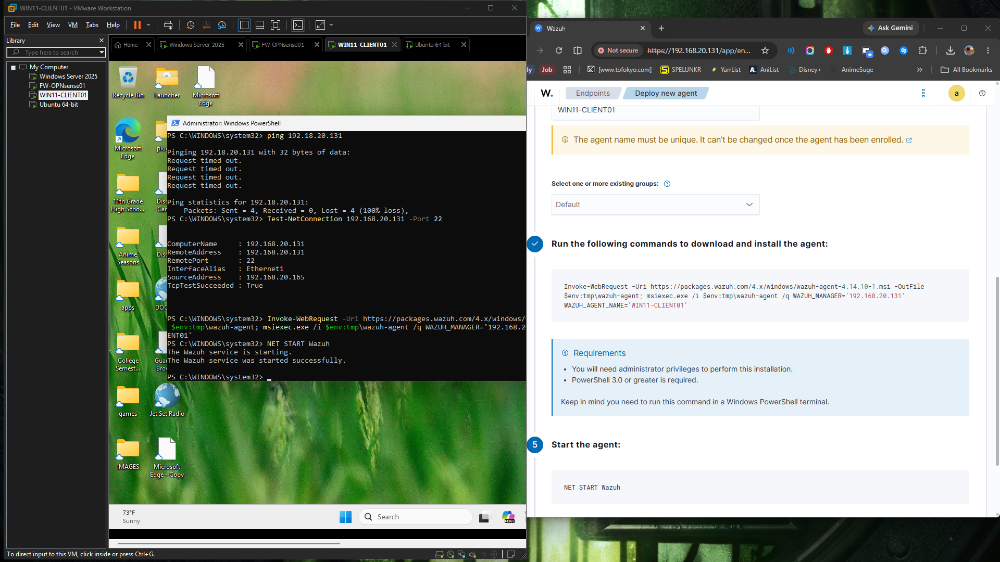
Evidence copied from [logs/2026-11-17.md](https://github.com/harkdev1/CyberOps-Sandbox/blob/main/logs/2026-11-17.md) and verified against the source image.

### Wazuh Powershell Configuration

Evidence copied from [logs/2026-11-17.md](https://github.com/harkdev1/CyberOps-Sandbox/blob/main/logs/2026-11-17.md) and verified against the source image.

### Wazuh Windows Endpoint Investigation
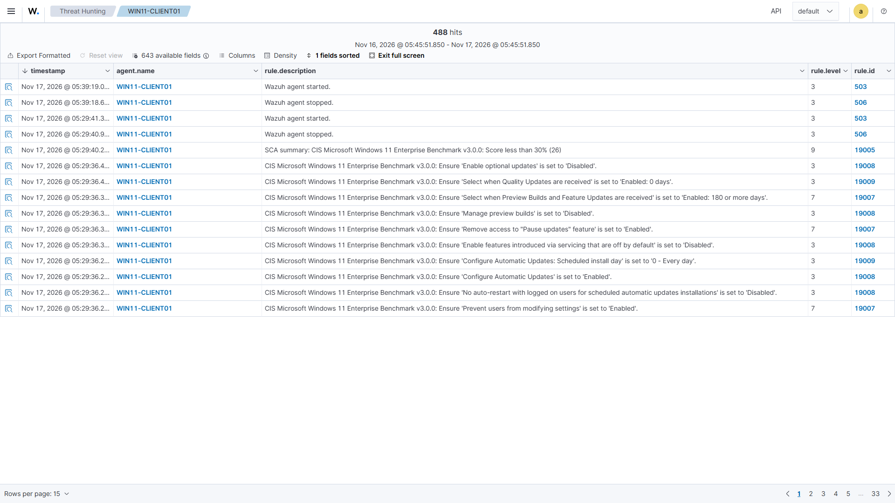
Evidence copied from [logs/2026-11-17.md](https://github.com/harkdev1/CyberOps-Sandbox/blob/main/logs/2026-11-17.md) and verified against the source image.

### Raw Event Archiving Configuration

Evidence copied from [logs/2026-11-17.md](https://github.com/harkdev1/CyberOps-Sandbox/blob/main/logs/2026-11-17.md) and verified against the source image.

### Wazuh Powershell Event Ingestion Confirmed

Evidence copied from [logs/2026-11-17.md](https://github.com/harkdev1/CyberOps-Sandbox/blob/main/logs/2026-11-17.md) and verified against the source image.

### Wazuh Services Operational

Evidence copied from [logs/2026-11-16.md](https://github.com/harkdev1/CyberOps-Sandbox/blob/main/logs/2026-11-16.md) and verified against the source image.

### Wazuh Dashboard Accessible
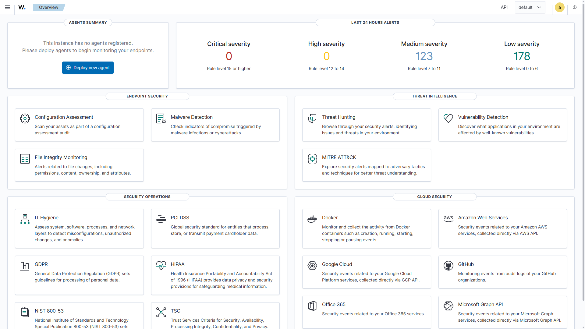
Evidence copied from [logs/2026-11-16.md](https://github.com/harkdev1/CyberOps-Sandbox/blob/main/logs/2026-11-16.md) and verified against the source image.

### Ubuntu Storage Configuration

Evidence copied from [logs/2026-11-03.md](https://github.com/harkdev1/CyberOps-Sandbox/blob/main/logs/2026-11-03.md) and verified against the source image.

### Ubuntu Username Recovery after forgetting

Evidence copied from [logs/2026-11-03.md](https://github.com/harkdev1/CyberOps-Sandbox/blob/main/logs/2026-11-03.md) and verified against the source image.

### Ubuntu Server First Login
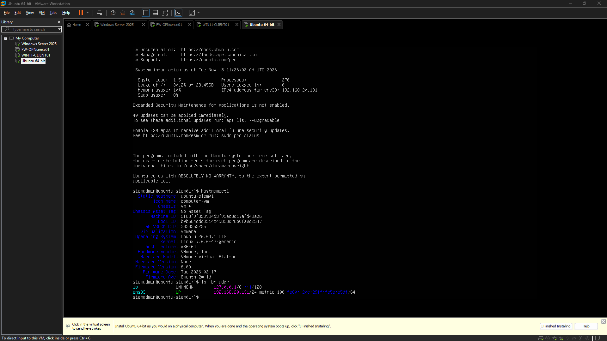
Evidence copied from [logs/2026-11-03.md](https://github.com/harkdev1/CyberOps-Sandbox/blob/main/logs/2026-11-03.md) and verified against the source image.

### Ubuntu SSH Service Running
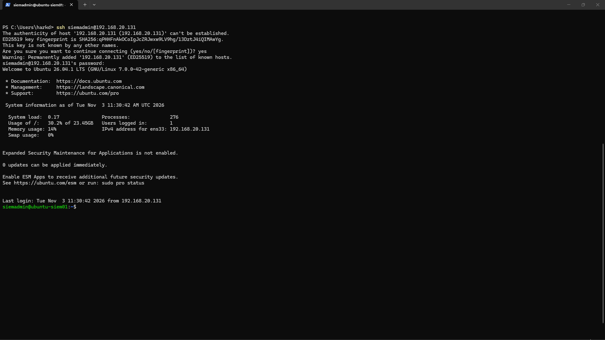
Evidence copied from [logs/2026-11-03.md](https://github.com/harkdev1/CyberOps-Sandbox/blob/main/logs/2026-11-03.md) and verified against the source image.

### Endpoint Baseline Initial Audit
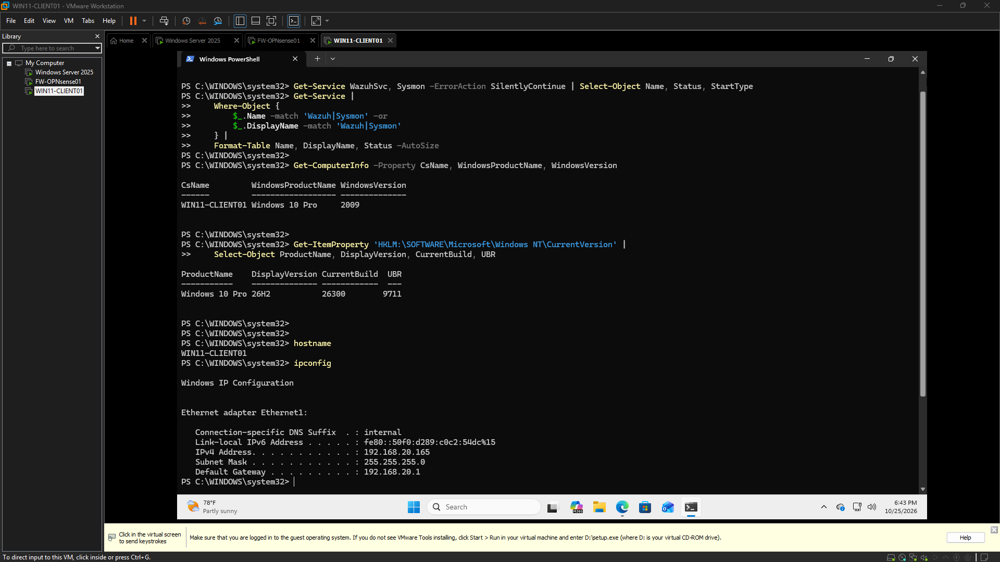
Evidence copied from [logs/2026-10-25.md](https://github.com/harkdev1/CyberOps-Sandbox/blob/main/logs/2026-10-25.md) and verified against the source image.

### Security Log Baseline
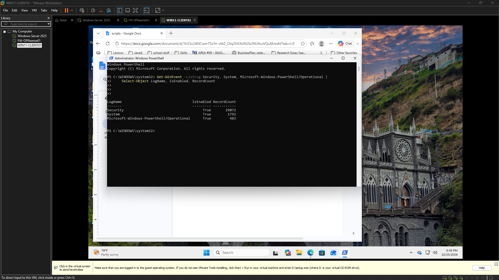
Evidence copied from [logs/2026-10-25.md](https://github.com/harkdev1/CyberOps-Sandbox/blob/main/logs/2026-10-25.md) and verified against the source image.

### Telemetry Visibility Gap
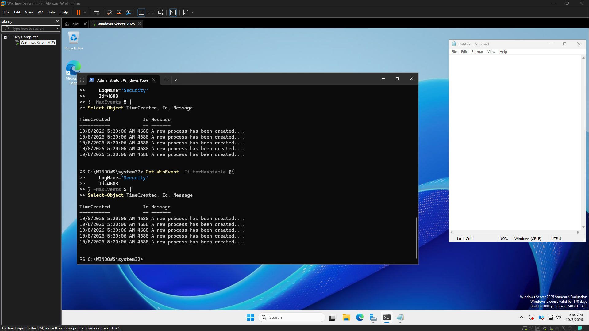
Evidence copied from [logs/2026-10-08.md](https://github.com/harkdev1/CyberOps-Sandbox/blob/main/logs/2026-10-08.md) and verified against the source image.

### Process Creation Telemetry

Evidence copied from [logs/2026-10-07.md](https://github.com/harkdev1/CyberOps-Sandbox/blob/main/logs/2026-10-07.md) and verified against the source image.

### Security Event Distribution
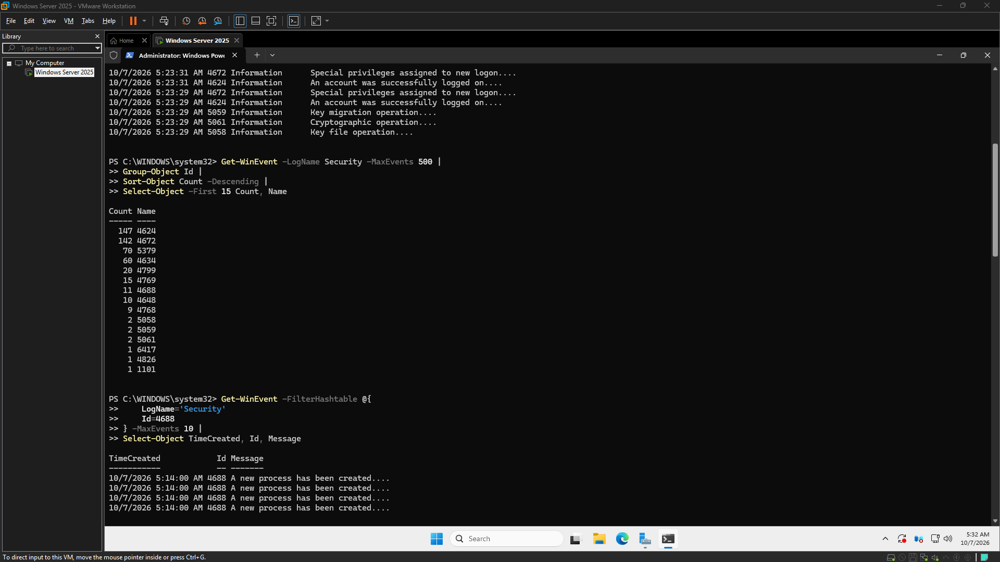
Evidence copied from [logs/2026-10-07.md](https://github.com/harkdev1/CyberOps-Sandbox/blob/main/logs/2026-10-07.md) and verified against the source image.

### CyberOps Baseline v0.1
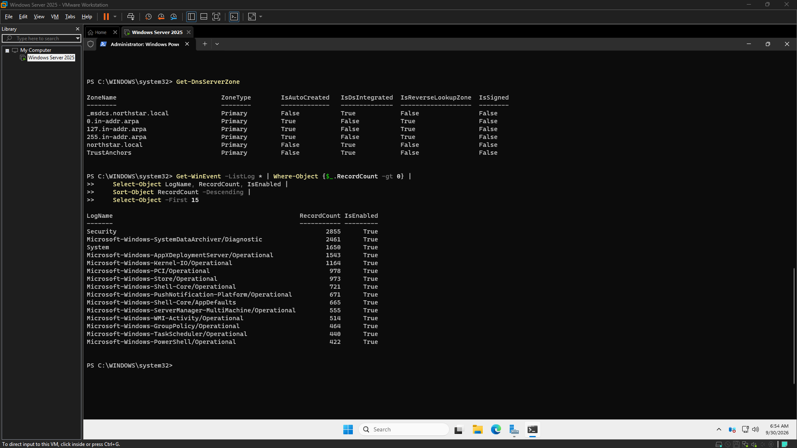
Evidence copied from [logs/2026-09-30.md](https://github.com/harkdev1/CyberOps-Sandbox/blob/main/logs/2026-09-30.md) and verified against the source image.

### Wazuh Filebeat Archive Forwarding Enabled
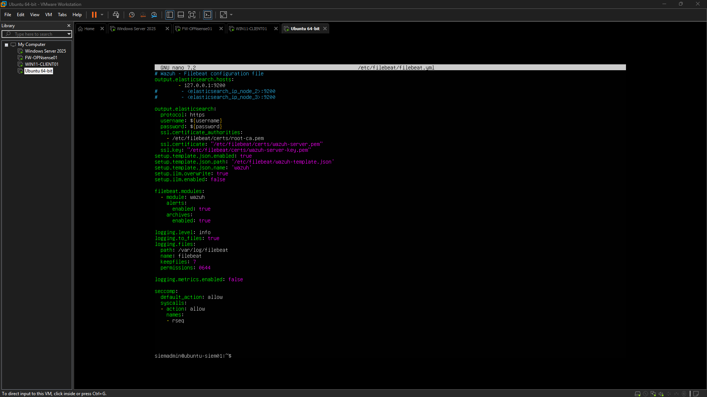
Evidence copied from [logs/2026-11-18.md](https://github.com/harkdev1/CyberOps-Sandbox/blob/main/logs/2026-11-18.md) and verified against the source image.

### Wazuh Powershell Event Dashboard Visibility
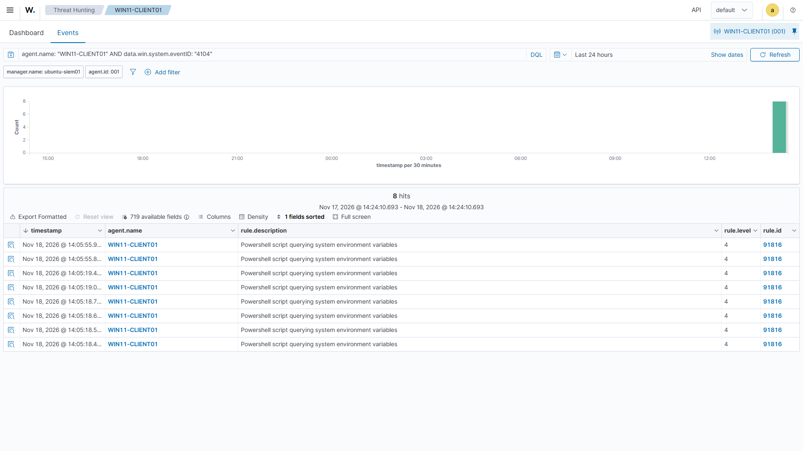
Evidence copied from [logs/2026-11-18.md](https://github.com/harkdev1/CyberOps-Sandbox/blob/main/logs/2026-11-18.md) and verified against the source image.

## Session highlights

### 2026-11-18 · 14:08 to 14:40
Recorded outcome: ❌ No. Improving centralized PowerShell telemetry visibility, identifying and correcting disabled Filebeat archive forwarding, inspecting actual Windows Script Block Logging records, validating controlled endpoint activity through raw SIEM archives, distinguishing successful ingestion from dashboard indexing limitations, establishing a foundation for subsequent detection engineering.
[Open the original AutoDoc log](https://github.com/harkdev1/CyberOps-Sandbox/blob/main/logs/2026-11-18.md)

### 2026-11-17 · 05:05 to 06:11
Recorded outcome: ✅ Yes. Successful implementation and validation of end-to-end Windows PowerShell telemetry collection, enabling script-block auditing on the endpoint, configuring Wazuh to retain raw JSON events, troubleshooting and correcting the manager configuration, proving that controlled Event ID 4104 records traveled from the Windows endpoint to the centralized SIEM.
[Open the original AutoDoc log](https://github.com/harkdev1/CyberOps-Sandbox/blob/main/logs/2026-11-17.md)

### 2026-11-16 · 07:12 to 08:01
Recorded outcome: ✅ Yes. Establishing a compatible SIEM server environment, rebuilding the Ubuntu infrastructure while preserving VMware hardware configuration, configuring secure remote administration, deploying and recovering a centralized security monitoring stack, validating service health and dashboard accessibility, overcoming infrastructure resource constraints.
[Open the original AutoDoc log](https://github.com/harkdev1/CyberOps-Sandbox/blob/main/logs/2026-11-16.md)

### 2026-11-04 · 05:49 to 06:19
Recorded outcome: ❌ No. Reviewed Ubuntu 26.04.1 compatibility with the Wazuh deployment, verified the Wazuh signing key, identified Ubuntu Server 24.04 LTS as the documented installation target, obtained the Ubuntu Server 24.04.5 ISO, prepared the existing virtual machine for OS replacement.
[Open the original AutoDoc log](https://github.com/harkdev1/CyberOps-Sandbox/blob/main/logs/2026-11-04.md)

### 2026-11-03 · 05:57 to 06:34
Recorded outcome: ✅ Yes. A dedicated Ubuntu Server 26.04.1 LTS virtual machine has been successfully provisioned in VMware, establishing a foundational Linux server for centralized security monitoring. The VM was integrated into the existing segmented OPNsense LAN, with core system configuration, network validation, and remote administration capabilities established. This prepares the environment for future Wazuh deployment without requiring a rebuild of existing infrastructure.
[Open the original AutoDoc log](https://github.com/harkdev1/CyberOps-Sandbox/blob/main/logs/2026-11-03.md)

### 2026-10-26 · 05:52 to 06:38
Recorded outcome: ✅ Yes. Significant progress was made in establishing foundational infrastructure and planning for the development of security operations capabilities. Key activities included reviewing existing network infrastructure, confirming baseline checks, establishing remaining Month 1 tasks, and planning for Wazuh deployment. The primary constraint identified is limited host memory, which requires further evaluation before proceeding with new installations.
[Open the original AutoDoc log](https://github.com/harkdev1/CyberOps-Sandbox/blob/main/logs/2026-10-26.md)

### 2026-10-25 · 18:32 to 18:48
Recorded outcome: ✅ Yes. Initial validation of the existing lab infrastructure was performed to establish an evidence-based starting point for the November CyberOps SIEM and detection engineering work. This involved reviewing network baselines, verifying endpoint network identity and connectivity, and confirming the status of core Windows event logging sources on a target workstation. A key finding was the absence of dedicated endpoint telemetry agents, identifying telemetry collection as the next critical technical milestone. No system or network configuration changes were made, preserving the existing infrastructure.
[Open the original AutoDoc log](https://github.com/harkdev1/CyberOps-Sandbox/blob/main/logs/2026-10-25.md)

### 2026-10-11 · 10:55 to 11:07
Recorded outcome: ✅ Yes. Current efforts focused on establishing a verified baseline configuration for NS-DC01, documenting its existing state, and identifying reusable administrative assets from Project 1. This foundational work is crucial for preparing the environment for Project 2, with a strong emphasis on preserving current capabilities and avoiding premature changes.
[Open the original AutoDoc log](https://github.com/harkdev1/CyberOps-Sandbox/blob/main/logs/2026-10-11.md)

### 2026-10-08 · 05:19 to 05:30
Recorded outcome: ✅ Yes. An initial experimental session was conducted within the CyberOps Sandbox on NS-DC01 to evaluate the reliability of existing Windows Security telemetry in observing intentional, simple process and file activities. The session established that the current Security log configuration does not reliably expose the tested activities, identifying significant visibility gaps. This work underscores a hands-on, experimental methodology focused on understanding and improving telemetry from the ground up, treating failures to observe expected activity as critical engineering findings.
[Open the original AutoDoc log](https://github.com/harkdev1/CyberOps-Sandbox/blob/main/logs/2026-10-08.md)

### 2026-10-07 · 05:12 to 05:17
Recorded outcome: ❌ No. The previous work session has been deemed unsatisfactory and requires a complete re-execution. No tasks from this session can be considered successfully completed at this time.
[Open the original AutoDoc log](https://github.com/harkdev1/CyberOps-Sandbox/blob/main/logs/2026-10-07.md)

### 2026-09-30 · 06:46 to 06:55
Recorded outcome: ✅ Yes. Initial project baselining activities have been completed, with key specifications documented.
[Open the original AutoDoc log](https://github.com/harkdev1/CyberOps-Sandbox/blob/main/logs/2026-09-30.md)

## Current limitations and next steps
The latest controlled Get-LocalUser events were confirmed in the Wazuh manager's raw archive. The remaining issue is confirming their visibility in the Wazuh Dashboard. Resume by investigating archive indexing and dashboard searchability without rebuilding or unnecessarily modifying the working telemetry pipeline. After that, proceed with detection engineering.

## Project files
- [Current project status](https://github.com/harkdev1/CyberOps-Sandbox/blob/main/project-status.md)
- [Short project summary](https://github.com/harkdev1/CyberOps-Sandbox/blob/main/docs/project-complete-short.md)
- [Full project history](https://github.com/harkdev1/CyberOps-Sandbox/blob/main/docs/project-complete-long.md)
- [Evidence index](evidence-index.md)

---
Screenshots are copied only from image references present in AutoDoc logs. Review each image for private details before publishing.
Gallery folder: `projects/cyberops-sandbox/screenshots/`.
<!-- autodoc:project-showcase:end -->

AutoDoc adds images referenced by the project's logs and session highlights here after a successful `autodoc finish` or `autodoc project complete` sync.
