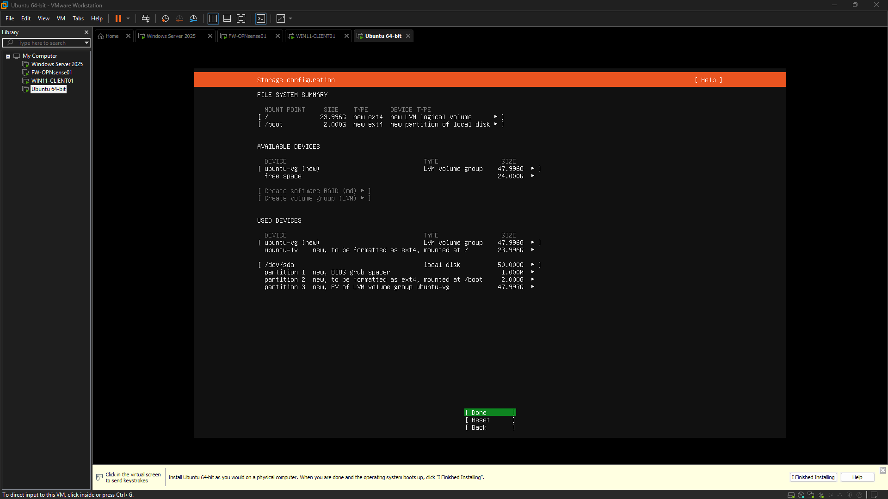
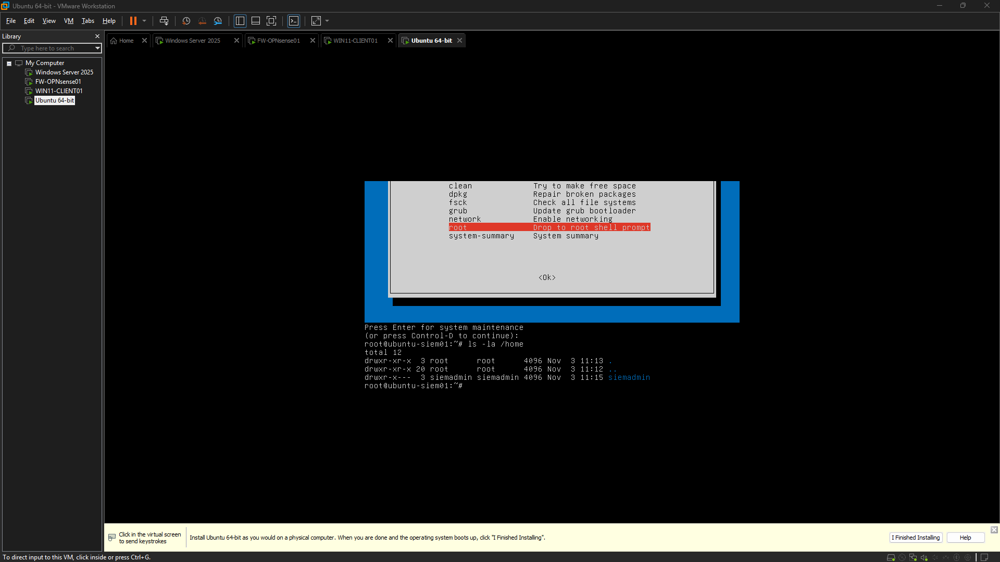
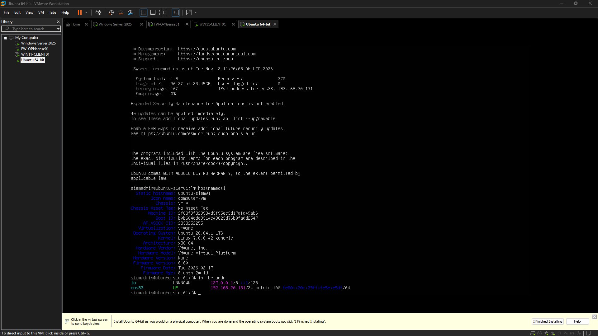
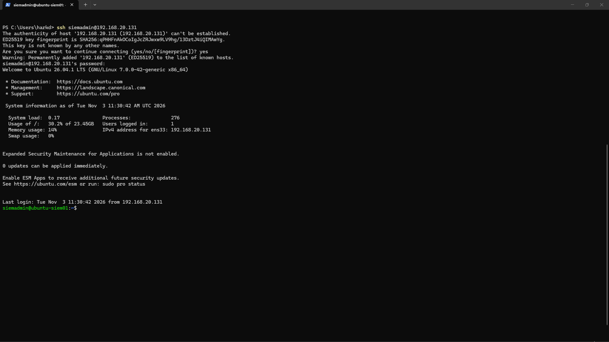
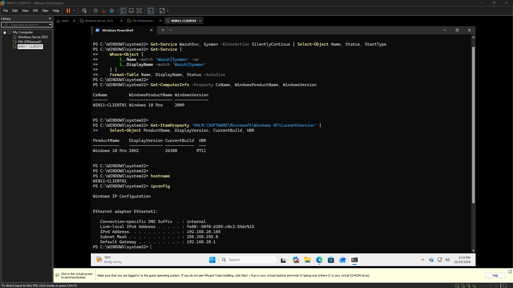
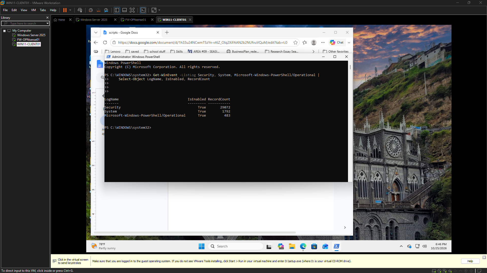
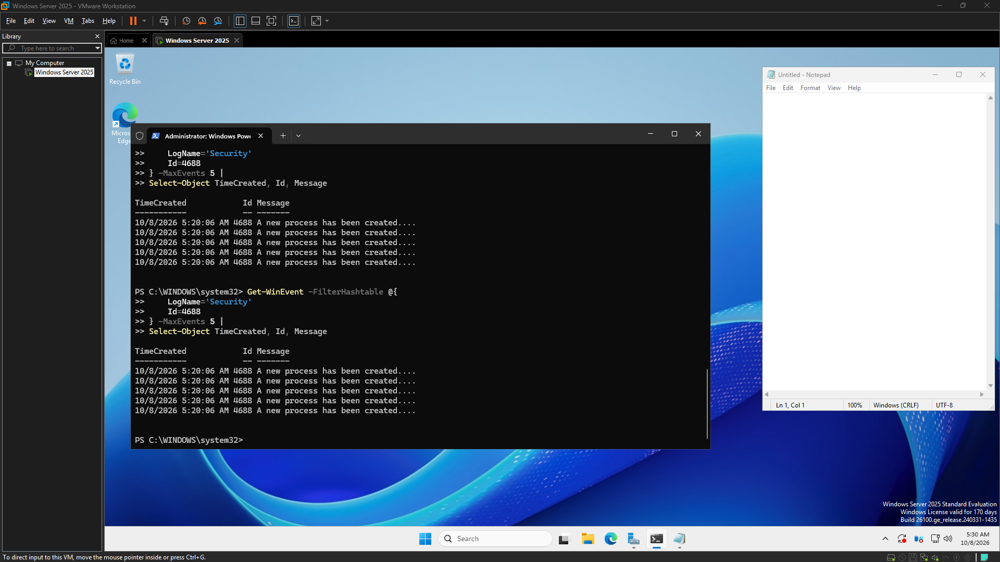
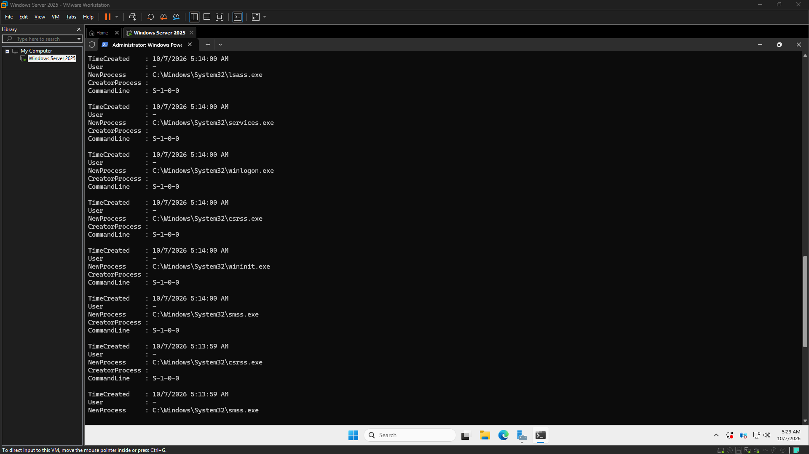
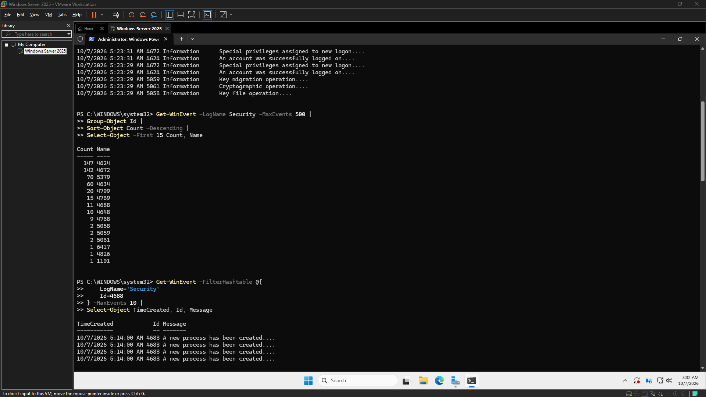
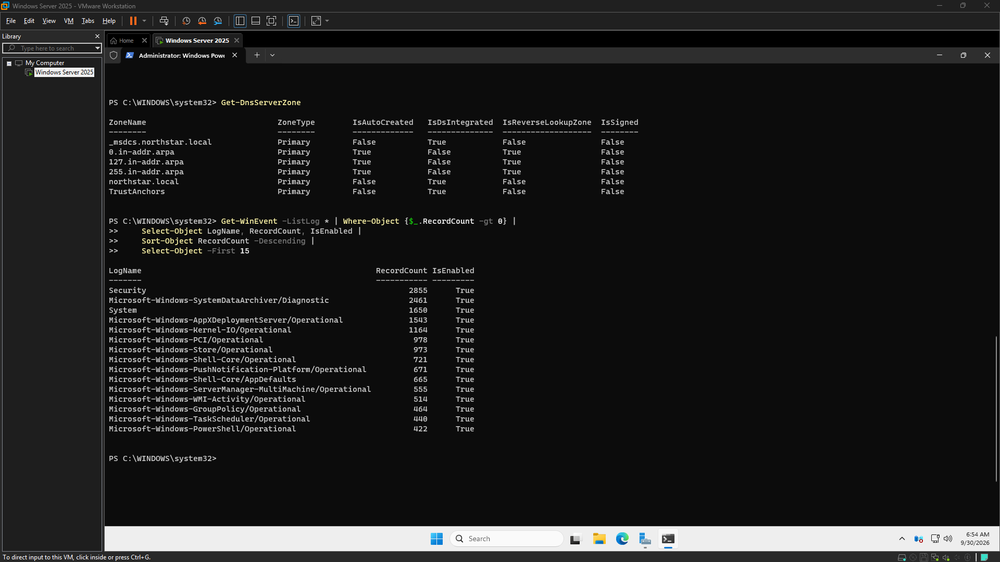

# CyberOps Homelab Evidence

The screenshots displayed here are copied from image references in the original AutoDoc logs. Source code and full session history remain in the [CyberOps-Sandbox GitHub repository](https://github.com/harkdev1/CyberOps-Sandbox).

## What the evidence establishes

- **Baseline, 2026-09-30:** A screenshot shows PowerShell queries of Northstar DNS zones and enabled Windows event-log record counts. It records the starting operational context; it does not establish an alerting pipeline.
- **Process telemetry, 2026-10-07:** The source log records inspection of security events and process-creation telemetry. It is exploratory evidence, not proof that every test action was reliably attributed.
- **Event distribution, 2026-10-07:** The screenshot shows counts of Security event IDs in a bounded recent sample. Counts are context, not detections or attribution.
- **Visibility gap, 2026-10-08:** The screenshot and log document that the tested process/file activity was not reliably visible with the then-current audit configuration. This negative result is a finding; it is not a successful detection claim.

## Source logs

- [Initial environment baseline, 2026-09-30](https://github.com/harkdev1/CyberOps-Sandbox/blob/main/logs/2026-09-30.md)
- [Security-event and process-telemetry investigation, 2026-10-07](https://github.com/harkdev1/CyberOps-Sandbox/blob/main/logs/2026-10-07.md)
- [Telemetry visibility-gap investigation, 2026-10-08](https://github.com/harkdev1/CyberOps-Sandbox/blob/main/logs/2026-10-08.md)

## Transferred screenshots

<!-- autodoc:evidence-gallery:start -->
### Ubuntu Storage Configuration

The source log labels this capture “Ubuntu Storage Configuration.”
Source: [logs/2026-11-03.md](https://github.com/harkdev1/CyberOps-Sandbox/blob/main/logs/2026-11-03.md). Image copied from the log reference and SHA-256 verified.

### Ubuntu Username Recovery after forgetting

The source log labels this capture “Ubuntu Username Recovery after forgetting.”
Source: [logs/2026-11-03.md](https://github.com/harkdev1/CyberOps-Sandbox/blob/main/logs/2026-11-03.md). Image copied from the log reference and SHA-256 verified.

### Ubuntu Server First Login

The source log labels this capture “Ubuntu Server First Login.”
Source: [logs/2026-11-03.md](https://github.com/harkdev1/CyberOps-Sandbox/blob/main/logs/2026-11-03.md). Image copied from the log reference and SHA-256 verified.

### Ubuntu SSH Service Running

The source log labels this capture “Ubuntu SSH Service Running.”
Source: [logs/2026-11-03.md](https://github.com/harkdev1/CyberOps-Sandbox/blob/main/logs/2026-11-03.md). Image copied from the log reference and SHA-256 verified.

### Endpoint Baseline Initial Audit

The source log labels this capture “Endpoint Baseline Initial Audit.”
Source: [logs/2026-10-25.md](https://github.com/harkdev1/CyberOps-Sandbox/blob/main/logs/2026-10-25.md). Image copied from the log reference and SHA-256 verified.

### Security Log Baseline

The source log labels this capture “Security Log Baseline.”
Source: [logs/2026-10-25.md](https://github.com/harkdev1/CyberOps-Sandbox/blob/main/logs/2026-10-25.md). Image copied from the log reference and SHA-256 verified.

### Telemetry Visibility Gap

The source log labels this capture “Telemetry Visibility Gap.”
Source: [logs/2026-10-08.md](https://github.com/harkdev1/CyberOps-Sandbox/blob/main/logs/2026-10-08.md). Image copied from the log reference and SHA-256 verified.

### Process Creation Telemetry

The source log labels this capture “Process Creation Telemetry.”
Source: [logs/2026-10-07.md](https://github.com/harkdev1/CyberOps-Sandbox/blob/main/logs/2026-10-07.md). Image copied from the log reference and SHA-256 verified.

### Security Event Distribution

The source log labels this capture “Security Event Distribution.”
Source: [logs/2026-10-07.md](https://github.com/harkdev1/CyberOps-Sandbox/blob/main/logs/2026-10-07.md). Image copied from the log reference and SHA-256 verified.

### CyberOps Baseline v0.1

The source log labels this capture “CyberOps Baseline v0.1.”
Source: [logs/2026-09-30.md](https://github.com/harkdev1/CyberOps-Sandbox/blob/main/logs/2026-09-30.md). Image copied from the log reference and SHA-256 verified.
<!-- autodoc:evidence-gallery:end -->

AutoDoc refreshes this section from image links in the source logs. Each image is copied into this Roadmap folder and checked against the source bytes before it is committed.
