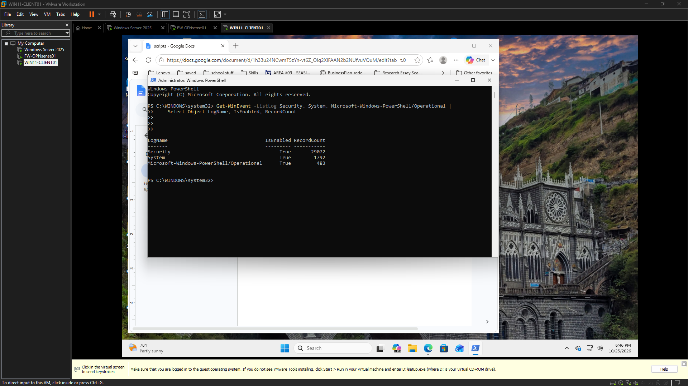
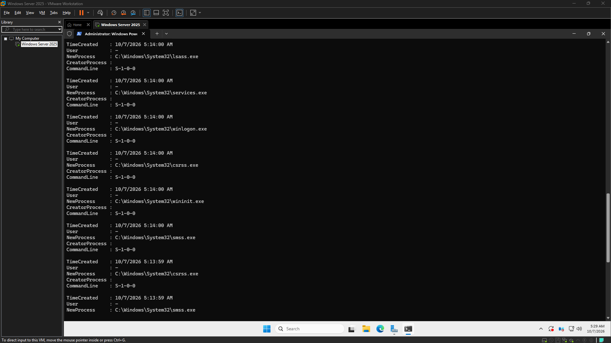

# CyberOps Homelab Evidence

The screenshots displayed here are copied from image references in the original AutoDoc logs. Source code and full session history remain in the [CyberOps-Sandbox GitHub repository](https://github.com/harkdev1/CyberOps-Sandbox).

## What the evidence establishes

- **Baseline, 2026-09-30:** A screenshot shows PowerShell queries of Northstar DNS zones and enabled Windows event-log record counts. It records the starting operational context; it does not establish an alerting pipeline.
- **Process telemetry, 2026-10-07:** The source log records inspection of security events and process-creation telemetry. It is exploratory evidence, not proof that every test action was reliably attributed.
- **Event distribution, 2026-10-07:** The screenshot shows counts of Security event IDs in a bounded recent sample. Counts are context, not detections or attribution.
- **Visibility gap, 2026-10-08:** The screenshot and log document that the tested process/file activity was not reliably visible with the then-current audit configuration. This negative result is a finding; it is not a successful detection claim.

## Source logs

- [Initial environment baseline, 2026-09-30](https://github.com/harkdev1/CyberOps-Sandbox/blob/main/logs/2026-09-30.md)
- [Security-event and process-telemetry investigation, 2026-10-07](https://github.com/harkdev1/CyberOps-Sandbox/blob/main/logs/2026-10-07.md)
- [Telemetry visibility-gap investigation, 2026-10-08](https://github.com/harkdev1/CyberOps-Sandbox/blob/main/logs/2026-10-08.md)

## Transferred screenshots

<!-- autodoc:evidence-gallery:start -->
### Endpoint Baseline Initial Audit

This screenshot captures the most important project evidence for the current phase, showing the main state, artifact, or operational view being reviewed. It highlights the key detail the viewer should notice in this stage of the project.
Source: [logs/2026-10-25.md](https://github.com/harkdev1/CyberOps-Sandbox/blob/main/logs/2026-10-25.md). Image copied from the log reference and SHA-256 verified.

### Security Log Baseline

This screenshot shows the telemetry or evidence being reviewed to understand the current system behavior and validate what the environment is actually recording. It highlights the key detail the viewer should notice in this stage of the project.
Source: [logs/2026-10-25.md](https://github.com/harkdev1/CyberOps-Sandbox/blob/main/logs/2026-10-25.md). Image copied from the log reference and SHA-256 verified.

### Telemetry Visibility Gap

This screenshot shows the telemetry or evidence being reviewed to understand the current system behavior and validate what the environment is actually recording. It highlights the key detail the viewer should notice in this stage of the project.
Source: [logs/2026-10-08.md](https://github.com/harkdev1/CyberOps-Sandbox/blob/main/logs/2026-10-08.md). Image copied from the log reference and SHA-256 verified.

### Process Creation Telemetry

This screenshot shows the telemetry or evidence being reviewed to understand the current system behavior and validate what the environment is actually recording. It highlights the key detail the viewer should notice in this stage of the project.
Source: [logs/2026-10-07.md](https://github.com/harkdev1/CyberOps-Sandbox/blob/main/logs/2026-10-07.md). Image copied from the log reference and SHA-256 verified.

### Security Event Distribution

This screenshot shows the telemetry or evidence being reviewed to understand the current system behavior and validate what the environment is actually recording. It highlights the key detail the viewer should notice in this stage of the project.
Source: [logs/2026-10-07.md](https://github.com/harkdev1/CyberOps-Sandbox/blob/main/logs/2026-10-07.md). Image copied from the log reference and SHA-256 verified.

### CyberOps Baseline v0.1

This screenshot captures the most important project evidence for the current phase, showing the main state, artifact, or operational view being reviewed. It highlights the key detail the viewer should notice in this stage of the project.
Source: [logs/2026-09-30.md](https://github.com/harkdev1/CyberOps-Sandbox/blob/main/logs/2026-09-30.md). Image copied from the log reference and SHA-256 verified.
<!-- autodoc:evidence-gallery:end -->

AutoDoc refreshes this section from image links in the source logs. Each image is copied into this Roadmap folder and checked against the source bytes before it is committed.
