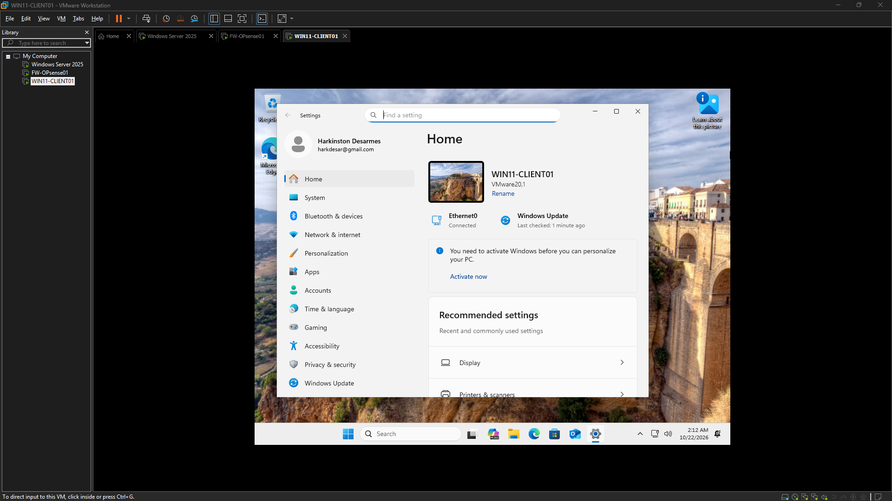
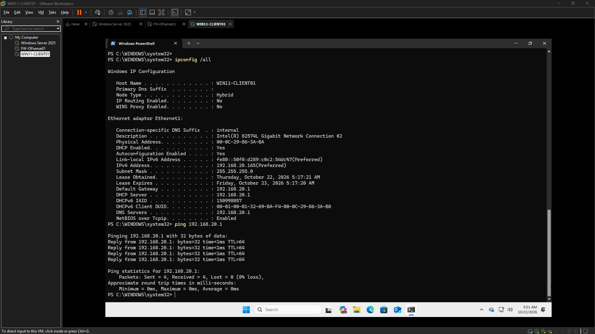
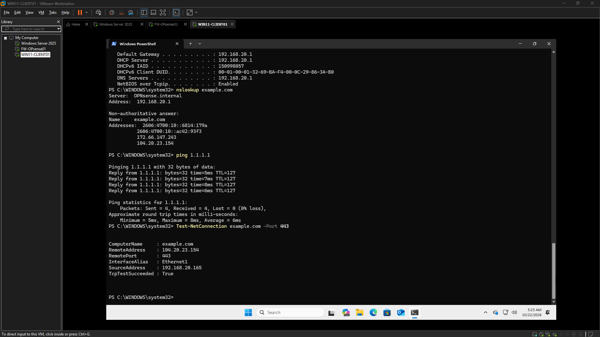
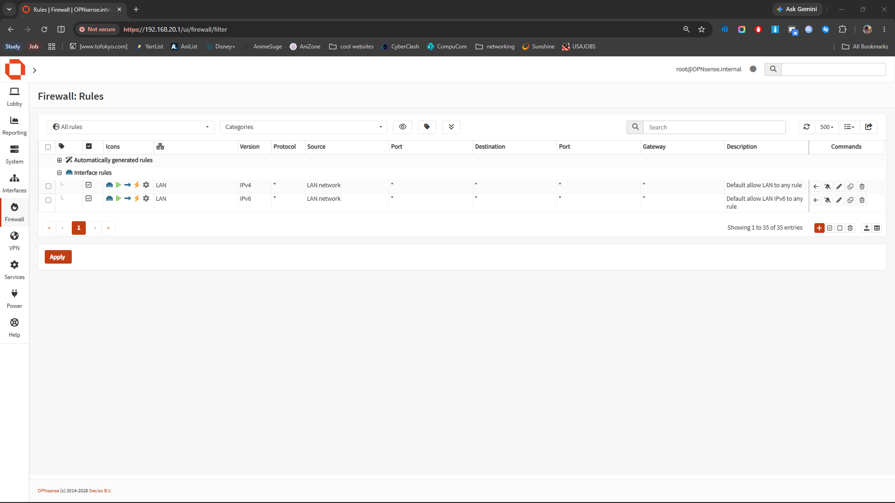
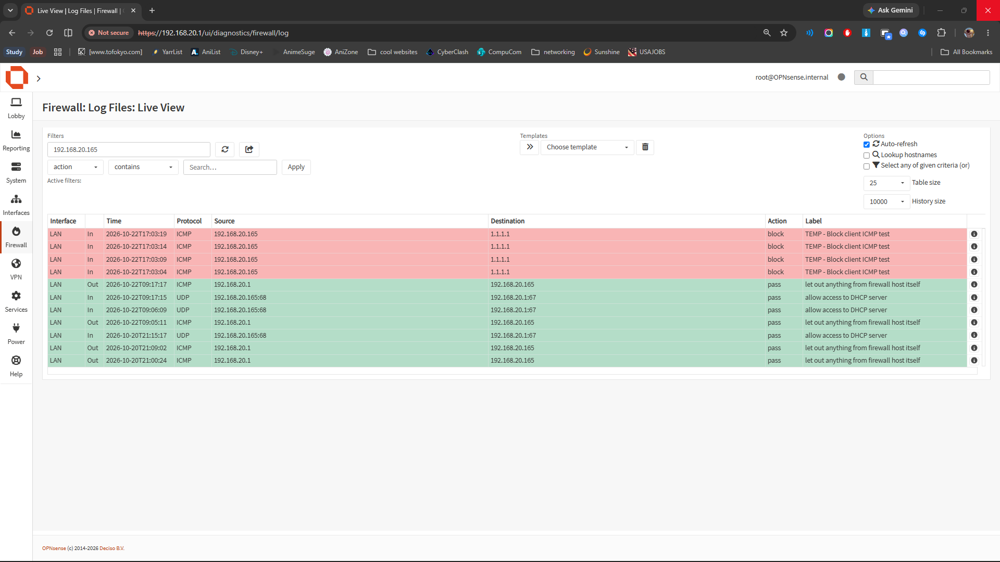
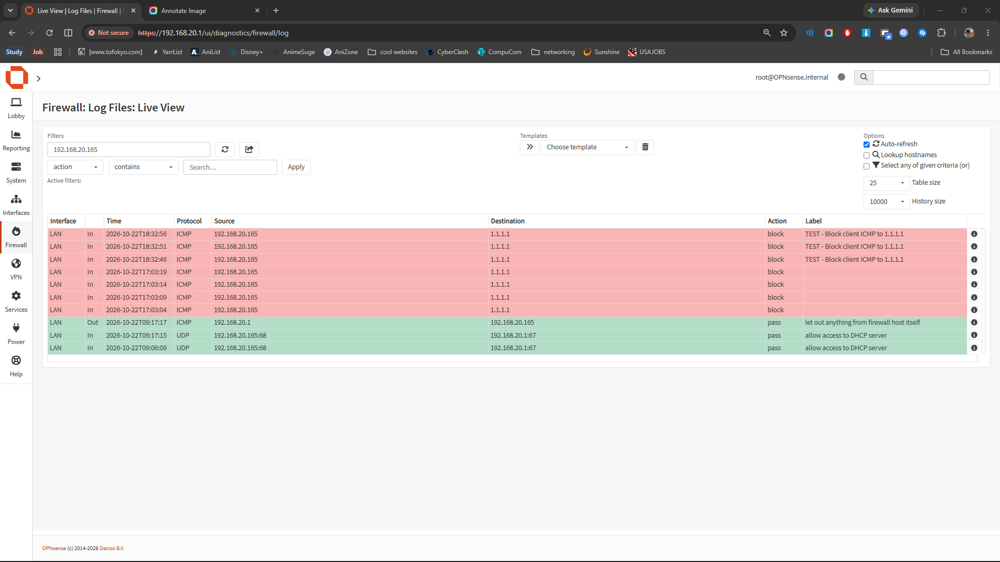
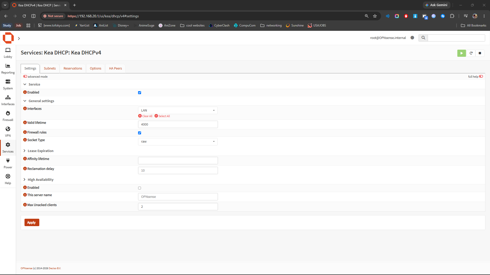
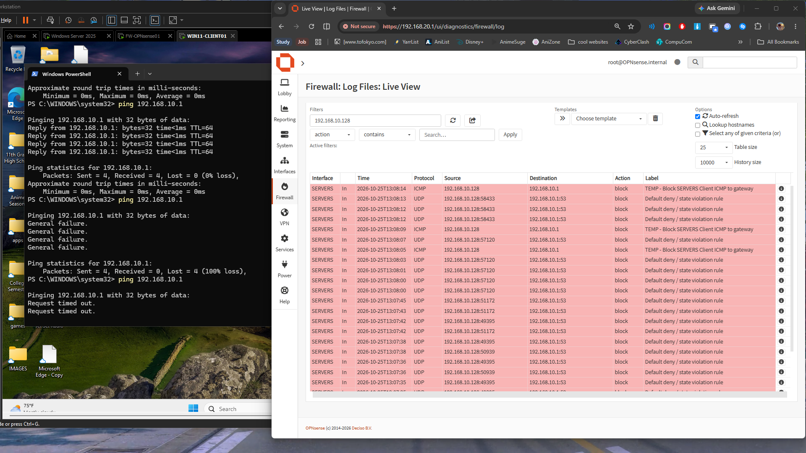

# Networking & Infrastructure Engineering

## Showcase

<!-- autodoc:project-showcase:start -->
**Status:** In progress
**Source repository:** [https://github.com/harkdev1/networking-infrastructure-engineering](https://github.com/harkdev1/networking-infrastructure-engineering)

## What I built
Validated OPNsense SERVERS interface at 192.168.10.1/24, connected WIN11-CLIENT01 to VMnet1 as a temporary test endpoint, confirmed gateway reachability with 4/4 successful ICMP replies, created and tested a temporary ICMP block rule, confirmed blocked traffic in OPNsense firewall logs

Summary:
An additional virtual network interface was configured on OPNsense, and endpoint-to-gateway connectivity was successfully demonstrated. Firewall enforcement was verified by creating and testing a temporary ICMP block rule, with traffic confirmation in live logs. However, an issue was identified where connectivity did not recover after the temporary firewall rule was removed, indicating a potential firewall cleanup problem requiring follow-up investigation.

Tasks Completed:
*   Validated the OPNsense SERVERS virtual network interface configuration at 192.168.10.1/24.
*   Connected WIN11-CLIENT01 to VMnet1, establishing it as a temporary test endpoint.
*   Confirmed successful endpoint-to-gateway connectivity from WIN11-CLIENT01 to OPNsense via ICMP, receiving 4/4 successful replies.
*   Created and tested a temporary ICMP block rule on OPNsense to deny ping traffic.
*   Confirmed that traffic was successfully blocked and recorded in the OPNsense firewall logs during the rule's active period.

Issues Encountered:
*   Connectivity from WIN11-CLIENT01 to the OPNsense gateway did not recover after the temporary ICMP block rule was removed.
*   Repeated ping tests did not resolve the connectivity loss.
*   It is suspected that firewall changes may have remained pending or unapplied, even after rule removal, preventing the restoration of network connectivity.

Next Steps:
*   Investigate the OPNsense firewall's state to determine why connectivity did not restore after rule removal (e.g., check `pfctl -sr` and `pfctl -si` for persistent rules or state table issues).
*   Attempt to manually reapply firewall rules or restart the firewall service to clear any stuck or unapplied configurations.
*   Re-establish and confirm endpoint-to-gateway connectivity from WIN11-CLIENT01.
*   Document procedures for ensuring proper firewall rule cleanup and application consistency on OPNsense.

Notes:
None.

## Evidence gallery
### WIN11-CLIENT Installation Complete

Evidence copied from [logs/2026-10-22.md](https://github.com/harkdev1/networking-infrastructure-engineering/blob/main/logs/2026-10-22.md) and verified against the source image.

### Win11 Client01 Single LAN DHCP Verified

Evidence copied from [logs/2026-10-22.md](https://github.com/harkdev1/networking-infrastructure-engineering/blob/main/logs/2026-10-22.md) and verified against the source image.

### Win11 Client01 Outbound Connectivity Test

Evidence copied from [logs/2026-10-22.md](https://github.com/harkdev1/networking-infrastructure-engineering/blob/main/logs/2026-10-22.md) and verified against the source image.

### OPNSense LAN Firewall Rules Baseline

Evidence copied from [logs/2026-10-22.md](https://github.com/harkdev1/networking-infrastructure-engineering/blob/main/logs/2026-10-22.md) and verified against the source image.

### OPNsense ICMP Block Log Evidence

Evidence copied from [logs/2026-10-22.md](https://github.com/harkdev1/networking-infrastructure-engineering/blob/main/logs/2026-10-22.md) and verified against the source image.

### OPNsense Firewall Test Results

Evidence copied from [logs/2026-10-22.md](https://github.com/harkdev1/networking-infrastructure-engineering/blob/main/logs/2026-10-22.md) and verified against the source image.

### OPNSense LAN DHCP Subnet

Evidence copied from [logs/2026-10-20.md](https://github.com/harkdev1/networking-infrastructure-engineering/blob/main/logs/2026-10-20.md) and verified against the source image.

### OPNsense Kea DHCP Service Status (Active)

Evidence copied from [logs/2026-10-20.md](https://github.com/harkdev1/networking-infrastructure-engineering/blob/main/logs/2026-10-20.md) and verified against the source image.

### WAN DHCP Success

Evidence copied from [logs/2026-10-13.md](https://github.com/harkdev1/networking-infrastructure-engineering/blob/main/logs/2026-10-13.md) and verified against the source image.

### WAN Default Route Validated

Evidence copied from [logs/2026-10-13.md](https://github.com/harkdev1/networking-infrastructure-engineering/blob/main/logs/2026-10-13.md) and verified against the source image.

### Network Topology Plan (Current)

Evidence copied from [logs/2026-10-13.md](https://github.com/harkdev1/networking-infrastructure-engineering/blob/main/logs/2026-10-13.md) and verified against the source image.

### WAN External Connectivity

Evidence copied from [logs/2026-10-13.md](https://github.com/harkdev1/networking-infrastructure-engineering/blob/main/logs/2026-10-13.md) and verified against the source image.

### WAN DNS Resolution

Evidence copied from [logs/2026-10-13.md](https://github.com/harkdev1/networking-infrastructure-engineering/blob/main/logs/2026-10-13.md) and verified against the source image.

### VMware DHCP Investigation

Evidence copied from [logs/2026-10-12.md](https://github.com/harkdev1/networking-infrastructure-engineering/blob/main/logs/2026-10-12.md) and verified against the source image.

### OPNsense Live Boot

Evidence copied from [logs/2026-10-11.md](https://github.com/harkdev1/networking-infrastructure-engineering/blob/main/logs/2026-10-11.md) and verified against the source image.

### Servers Firewall Log

Evidence copied from [logs/2026-10-25.md](https://github.com/harkdev1/networking-infrastructure-engineering/blob/main/logs/2026-10-25.md) and verified against the source image.

### Server Firewall Block Rule (Test)

Evidence copied from [logs/2026-10-25.md](https://github.com/harkdev1/networking-infrastructure-engineering/blob/main/logs/2026-10-25.md) and verified against the source image.

## Session highlights

### 2026-10-25 · 08:45 to 09:14
Recorded outcome: ✅ Yes. An additional virtual network interface was configured on OPNsense, and endpoint-to-gateway connectivity was successfully demonstrated. Firewall enforcement was verified by creating and testing a temporary ICMP block rule, with traffic confirmation in live logs. However, an issue was identified where connectivity did not recover after the temporary firewall rule was removed, indicating a potential firewall cleanup problem requiring follow-up investigation.
[Open the original AutoDoc log](https://github.com/harkdev1/networking-infrastructure-engineering/blob/main/logs/2026-10-25.md)

### 2026-10-22 · 05:05 to 05:36
Recorded outcome: ✅ Yes. The Windows 11 client is receiving a DHCP lease from OPNsense, can reach the LAN gateway, resolve public DNS names, reach the internet by IP, and establish an HTTPS connection.
[Open the original AutoDoc log](https://github.com/harkdev1/networking-infrastructure-engineering/blob/main/logs/2026-10-22.md)

### 2026-10-20 · 05:57 to 06:07
Recorded outcome: ❌ No. Initial configuration of the Kea DHCPv4 service on OPNsense 26.7 was performed, including verification of network interfaces and creation of a DHCP subnet with an address pool for the LAN network.
[Open the original AutoDoc log](https://github.com/harkdev1/networking-infrastructure-engineering/blob/main/logs/2026-10-20.md)

### 2026-10-16 · 05:24 to 05:51
Recorded outcome: ❌ No. Systematic network troubleshooting was performed on a virtualized OPNsense 26.7 firewall environment to resolve critical management connectivity issues. The primary problem identified was an IP address conflict between the OPNsense LAN interface (192.168.20.1/24) and the VMware VMnet2 host-only adapter on the Windows host. This conflict was successfully resolved by reconfiguring the host's VMnet2 adapter to 192.168.20.2/24. Post-resolution, OPNsense interface assignments, routing, and HTTPS listener functionality were verified, and successful TCP connectivity to the firewall's web interface on port 443 was established from the physical Windows host. This work...
[Open the original AutoDoc log](https://github.com/harkdev1/networking-infrastructure-engineering/blob/main/logs/2026-10-16.md)

### 2026-10-13 · 14:00 to 14:42
Recorded outcome: ✅ Yes. This session successfully addressed and resolved critical network connectivity issues for an OPNsense virtual appliance. The primary cause was identified as an incorrect mapping of VMware virtual network adapters to OPNsense WAN/LAN interfaces. After systematically correcting these assignments, full network functionality was restored. WAN DHCP was successfully obtained, routing verified, and external IP connectivity confirmed. DNS resolution was also validated. The session concluded with a documented network topology, establishing a stable and reproducible foundation for subsequent implementation phases.
[Open the original AutoDoc log](https://github.com/harkdev1/networking-infrastructure-engineering/blob/main/logs/2026-10-13.md)

### 2026-10-12 · 04:27 to 05:39
Recorded outcome: ❌ No. This documentation outlines the initial phase of troubleshooting a persistent WAN DHCP failure experienced by an OPNsense virtual machine within a VMware environment. Despite a systematic approach to verifying both the OPNsense client's behavior and the VMware virtual network configuration, the issue remains unresolved. Limited visibility into the DHCP negotiation process has hindered fault isolation. Recognizing diminishing returns from further configuration checks, the focus is now shifting to evidence-based, packet-level analysis to pinpoint the root cause.
[Open the original AutoDoc log](https://github.com/harkdev1/networking-infrastructure-engineering/blob/main/logs/2026-10-12.md)

### 2026-10-11 · 11:44 to 15:04
Recorded outcome: ❌ No. Installed and configured OPNsense 26.7 as the foundation for an isolated enterprise-style virtual network, established the LAN gateway at 192.168.20.1/24 and configured the DHCP pool for future lab clients, assigned WAN and LAN interfaces and verified VMware NAT addressing, investigated missing WAN IPv4 connectivity through interface inspection, routing-table analysis, DHCP lease inspection, and packet capture, identified repeated DHCP Discover requests without a visible DHCP Offer, documented the unresolved WAN DHCP issue and established a targeted troubleshooting plan for the next session.
[Open the original AutoDoc log](https://github.com/harkdev1/networking-infrastructure-engineering/blob/main/logs/2026-10-11.md)

### 2026-10-10 · 15:59
Recorded outcome: ✅ Yes. Established Project 2 workspace at D:\Projects\Networking-Infrastructure-Engineering, initialized AutoDoc, installed GitHub CLI and authenticated with GitHub, created the public networking-infrastructure-engineering repository, configured the origin remote and main branch, pushed the initial AutoDoc project structure to GitHub, enabled AutoDoc automatic synchronization. Next: finalize README and CHANGELOG, set repository description, verify the initial commit and prepare for Project 2 Session 1. ### Tasks Completed established repo ### Notes --- ## Session – 15:58 to 16:00 ### Goal Establish the Project 2 GitHub repository, initialize AutoDoc, enable automatic...
[Open the original AutoDoc log](https://github.com/harkdev1/networking-infrastructure-engineering/blob/main/logs/2026-10-10.md)

## Current limitations and next steps
- Continue from the handoff notes and current project status.
- Capture final cleanup or deployment follow-up items as they are completed.

## Project files
- [Current project status](https://github.com/harkdev1/networking-infrastructure-engineering/blob/main/project-status.md)
- [Short project summary](https://github.com/harkdev1/networking-infrastructure-engineering/blob/main/docs/project-complete-short.md)
- [Full project history](https://github.com/harkdev1/networking-infrastructure-engineering/blob/main/docs/project-complete-long.md)
- [Evidence index](evidence-index.md)

---
Screenshots are copied only from image references present in AutoDoc logs. Review each image for private details before publishing.
Gallery folder: `projects/networking-infrastructure-engineering/screenshots/`.
<!-- autodoc:project-showcase:end -->
