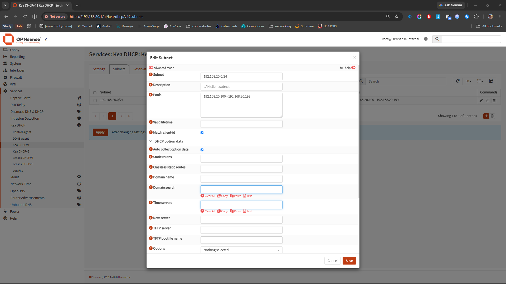

# Networking & Infrastructure Engineering

## Showcase

<!-- autodoc:project-showcase:start -->
**Status:** In progress
**Source repository:** [https://github.com/harkdev1/networking-infrastructure-engineering](https://github.com/harkdev1/networking-infrastructure-engineering)

## What I built
Accessed the OPNsense 26.7 web interface through the host-only LAN network, verified the LAN interface at 192.168.20.1/24 and host adapter at 192.168.20.2/24, inspected Kea DHCPv4 settings and confirmed the service was initially disabled with no interface selected, inspected the subnet configuration and found zero existing subnet entries, created a LAN subnet entry for 192.168.20.0/24 with the address pool 192.168.20.100–192.168.20.199, selected LAN as the Kea DHCPv4 service interface, checked the service Enabled option.

Summary:
Initial configuration of the Kea DHCPv4 service on OPNsense 26.7 was performed, including verification of network interfaces and creation of a DHCP subnet with an address pool for the LAN network.

Tasks Completed:
1.  Accessed the OPNsense 26.7 web interface through the host-only LAN network.
2.  Verified the LAN interface (192.168.20.1/24) and host adapter (192.168.20.2/24) network configurations.
3.  Inspected Kea DHCPv4 settings, confirming the service was initially disabled with no interface selected.
4.  Inspected subnet configuration, finding zero existing subnet entries.
5.  Created a LAN subnet entry for 192.168.20.0/24 with the address pool 192.168.20.100–192.168.20.199.
6.  Selected the LAN interface for the Kea DHCPv4 service.
7.  Checked the service 'Enabled' option for Kea DHCPv4.

Issues Encountered:
1.  The existing DHCP configuration was incomplete upon inspection.
2.  Required identification of the correct Kea DHCPv4 settings and subnet configuration pages within the OPNsense interface.
3.  Limited session time prevented applying the configuration and validating service operation.

Next Steps:
1.  Apply the configured Kea DHCPv4 settings.
2.  Validate the operation of the DHCPv4 service on the LAN interface by testing client IP address assignments.

Notes:
The work focused on the foundational setup of Kea DHCPv4 to provide IP addresses within the 192.168.20.0/24 network segment. The host-only network configuration was essential for initial access and verification.

## Evidence gallery
### WAN DHCP Success

Evidence copied from [logs/2026-10-13.md](https://github.com/harkdev1/networking-infrastructure-engineering/blob/main/logs/2026-10-13.md) and verified against the source image.

### WAN Default Route Validated

Evidence copied from [logs/2026-10-13.md](https://github.com/harkdev1/networking-infrastructure-engineering/blob/main/logs/2026-10-13.md) and verified against the source image.

### Network Topology Plan (Current)

Evidence copied from [logs/2026-10-13.md](https://github.com/harkdev1/networking-infrastructure-engineering/blob/main/logs/2026-10-13.md) and verified against the source image.

### WAN External Connectivity

Evidence copied from [logs/2026-10-13.md](https://github.com/harkdev1/networking-infrastructure-engineering/blob/main/logs/2026-10-13.md) and verified against the source image.

### WAN DNS Resolution

Evidence copied from [logs/2026-10-13.md](https://github.com/harkdev1/networking-infrastructure-engineering/blob/main/logs/2026-10-13.md) and verified against the source image.

### VMware DHCP Investigation

Evidence copied from [logs/2026-10-12.md](https://github.com/harkdev1/networking-infrastructure-engineering/blob/main/logs/2026-10-12.md) and verified against the source image.

### OPNsense Live Boot

Evidence copied from [logs/2026-10-11.md](https://github.com/harkdev1/networking-infrastructure-engineering/blob/main/logs/2026-10-11.md) and verified against the source image.

### OPNSense LAN DHCP Subnet

Evidence copied from [logs/2026-10-20.md](https://github.com/harkdev1/networking-infrastructure-engineering/blob/main/logs/2026-10-20.md) and verified against the source image.

## Session highlights

### 2026-10-20 · 05:57 to 06:07
Recorded outcome: ❌ No. Initial configuration of the Kea DHCPv4 service on OPNsense 26.7 was performed, including verification of network interfaces and creation of a DHCP subnet with an address pool for the LAN network.
[Open the original AutoDoc log](https://github.com/harkdev1/networking-infrastructure-engineering/blob/main/logs/2026-10-20.md)

### 2026-10-16 · 05:24 to 05:51
Recorded outcome: ❌ No. Systematic network troubleshooting was performed on a virtualized OPNsense 26.7 firewall environment to resolve critical management connectivity issues. The primary problem identified was an IP address conflict between the OPNsense LAN interface (192.168.20.1/24) and the VMware VMnet2 host-only adapter on the Windows host. This conflict was successfully resolved by reconfiguring the host's VMnet2 adapter to 192.168.20.2/24. Post-resolution, OPNsense interface assignments, routing, and HTTPS listener functionality were verified, and successful TCP connectivity to the firewall's web interface on port 443 was established from the physical Windows host. This work...
[Open the original AutoDoc log](https://github.com/harkdev1/networking-infrastructure-engineering/blob/main/logs/2026-10-16.md)

### 2026-10-13 · 14:00 to 14:42
Recorded outcome: ✅ Yes. This session successfully addressed and resolved critical network connectivity issues for an OPNsense virtual appliance. The primary cause was identified as an incorrect mapping of VMware virtual network adapters to OPNsense WAN/LAN interfaces. After systematically correcting these assignments, full network functionality was restored. WAN DHCP was successfully obtained, routing verified, and external IP connectivity confirmed. DNS resolution was also validated. The session concluded with a documented network topology, establishing a stable and reproducible foundation for subsequent implementation phases.
[Open the original AutoDoc log](https://github.com/harkdev1/networking-infrastructure-engineering/blob/main/logs/2026-10-13.md)

### 2026-10-12 · 04:27 to 05:39
Recorded outcome: ❌ No. This documentation outlines the initial phase of troubleshooting a persistent WAN DHCP failure experienced by an OPNsense virtual machine within a VMware environment. Despite a systematic approach to verifying both the OPNsense client's behavior and the VMware virtual network configuration, the issue remains unresolved. Limited visibility into the DHCP negotiation process has hindered fault isolation. Recognizing diminishing returns from further configuration checks, the focus is now shifting to evidence-based, packet-level analysis to pinpoint the root cause.
[Open the original AutoDoc log](https://github.com/harkdev1/networking-infrastructure-engineering/blob/main/logs/2026-10-12.md)

### 2026-10-11 · 11:44 to 15:04
Recorded outcome: ❌ No. Installed and configured OPNsense 26.7 as the foundation for an isolated enterprise-style virtual network, established the LAN gateway at 192.168.20.1/24 and configured the DHCP pool for future lab clients, assigned WAN and LAN interfaces and verified VMware NAT addressing, investigated missing WAN IPv4 connectivity through interface inspection, routing-table analysis, DHCP lease inspection, and packet capture, identified repeated DHCP Discover requests without a visible DHCP Offer, documented the unresolved WAN DHCP issue and established a targeted troubleshooting plan for the next session.
[Open the original AutoDoc log](https://github.com/harkdev1/networking-infrastructure-engineering/blob/main/logs/2026-10-11.md)

### 2026-10-10 · 15:59
Recorded outcome: ✅ Yes. Established Project 2 workspace at D:\Projects\Networking-Infrastructure-Engineering, initialized AutoDoc, installed GitHub CLI and authenticated with GitHub, created the public networking-infrastructure-engineering repository, configured the origin remote and main branch, pushed the initial AutoDoc project structure to GitHub, enabled AutoDoc automatic synchronization. Next: finalize README and CHANGELOG, set repository description, verify the initial commit and prepare for Project 2 Session 1. ### Tasks Completed established repo ### Notes --- ## Session – 15:58 to 16:00 ### Goal Establish the Project 2 GitHub repository, initialize AutoDoc, enable automatic...
[Open the original AutoDoc log](https://github.com/harkdev1/networking-infrastructure-engineering/blob/main/logs/2026-10-10.md)

## Current limitations and next steps
- Continue from the handoff notes and current project status.
- Capture final cleanup or deployment follow-up items as they are completed.

## Project files
- [Current project status](https://github.com/harkdev1/networking-infrastructure-engineering/blob/main/project-status.md)
- [Short project summary](https://github.com/harkdev1/networking-infrastructure-engineering/blob/main/docs/project-complete-short.md)
- [Full project history](https://github.com/harkdev1/networking-infrastructure-engineering/blob/main/docs/project-complete-long.md)
- [Evidence index](evidence-index.md)

---
Screenshots are copied only from image references present in AutoDoc logs. Review each image for private details before publishing.
Gallery folder: `projects/networking-infrastructure-engineering/screenshots/`.
<!-- autodoc:project-showcase:end -->
