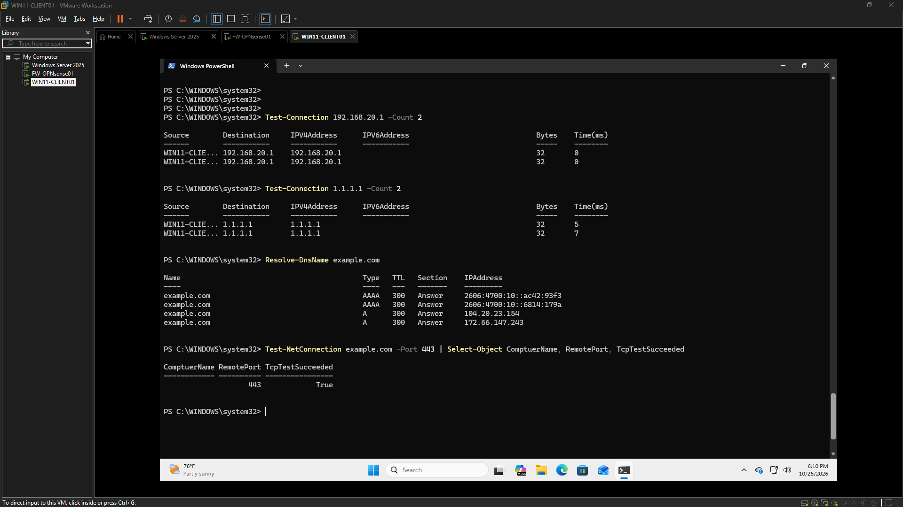

# Networking & Infrastructure Engineering Evidence Index

Screenshots below are copied only when referenced by an AutoDoc source log. Each transferred image is verified against its source bytes and linked back to that log.

## Transferred screenshots

<!-- autodoc:evidence-gallery:start -->
### Servers Firewall Log

This screenshot shows the current configuration or system state being reviewed as part of the active project setup, validation, or troubleshooting work. It highlights the key detail the viewer should notice in this stage of the project.
Source: [logs/2026-10-25.md](https://github.com/harkdev1/networking-infrastructure-engineering/blob/main/logs/2026-10-25.md). Image copied from the log reference and SHA-256 verified.

### Server Firewall Block Rule (Test)

This screenshot shows the current configuration or system state being reviewed as part of the active project setup, validation, or troubleshooting work. It highlights the key detail the viewer should notice in this stage of the project.
Source: [logs/2026-10-25.md](https://github.com/harkdev1/networking-infrastructure-engineering/blob/main/logs/2026-10-25.md). Image copied from the log reference and SHA-256 verified.

### WIN11-CLIENT Installation Complete

This screenshot captures the most important project evidence for the current phase, showing the main state, artifact, or operational view being reviewed. It highlights the key detail the viewer should notice in this stage of the project.
Source: [logs/2026-10-22.md](https://github.com/harkdev1/networking-infrastructure-engineering/blob/main/logs/2026-10-22.md). Image copied from the log reference and SHA-256 verified.

### Win11 Client01 Single LAN DHCP Verified

This screenshot captures the most important project evidence for the current phase, showing the main state, artifact, or operational view being reviewed. It highlights the key detail the viewer should notice in this stage of the project.
Source: [logs/2026-10-22.md](https://github.com/harkdev1/networking-infrastructure-engineering/blob/main/logs/2026-10-22.md). Image copied from the log reference and SHA-256 verified.

### Win11 Client01 Outbound Connectivity Test

This screenshot captures the most important project evidence for the current phase, showing the main state, artifact, or operational view being reviewed. It highlights the key detail the viewer should notice in this stage of the project.
Source: [logs/2026-10-22.md](https://github.com/harkdev1/networking-infrastructure-engineering/blob/main/logs/2026-10-22.md). Image copied from the log reference and SHA-256 verified.

### OPNSense LAN Firewall Rules Baseline

This screenshot captures the most important project evidence for the current phase, showing the main state, artifact, or operational view being reviewed. It highlights the key detail the viewer should notice in this stage of the project.
Source: [logs/2026-10-22.md](https://github.com/harkdev1/networking-infrastructure-engineering/blob/main/logs/2026-10-22.md). Image copied from the log reference and SHA-256 verified.

### OPNsense ICMP Block Log Evidence

This screenshot captures the most important project evidence for the current phase, showing the main state, artifact, or operational view being reviewed. It highlights the key detail the viewer should notice in this stage of the project.
Source: [logs/2026-10-22.md](https://github.com/harkdev1/networking-infrastructure-engineering/blob/main/logs/2026-10-22.md). Image copied from the log reference and SHA-256 verified.

### OPNsense Firewall Test Results

This screenshot captures the most important project evidence for the current phase, showing the main state, artifact, or operational view being reviewed. It highlights the key detail the viewer should notice in this stage of the project.
Source: [logs/2026-10-22.md](https://github.com/harkdev1/networking-infrastructure-engineering/blob/main/logs/2026-10-22.md). Image copied from the log reference and SHA-256 verified.

### OPNSense LAN DHCP Subnet

This screenshot captures the most important project evidence for the current phase, showing the main state, artifact, or operational view being reviewed. It highlights the key detail the viewer should notice in this stage of the project.
Source: [logs/2026-10-20.md](https://github.com/harkdev1/networking-infrastructure-engineering/blob/main/logs/2026-10-20.md). Image copied from the log reference and SHA-256 verified.

### OPNsense Kea DHCP Service Status (Active)

This screenshot shows the working interface or project state that is currently being shaped to communicate the latest status, progress, and story. It highlights the key detail the viewer should notice in this stage of the project.
Source: [logs/2026-10-20.md](https://github.com/harkdev1/networking-infrastructure-engineering/blob/main/logs/2026-10-20.md). Image copied from the log reference and SHA-256 verified.

### WAN DHCP Success

This screenshot captures the most important project evidence for the current phase, showing the main state, artifact, or operational view being reviewed. It highlights the key detail the viewer should notice in this stage of the project.
Source: [logs/2026-10-13.md](https://github.com/harkdev1/networking-infrastructure-engineering/blob/main/logs/2026-10-13.md). Image copied from the log reference and SHA-256 verified.

### WAN Default Route Validated

This screenshot captures the most important project evidence for the current phase, showing the main state, artifact, or operational view being reviewed. It highlights the key detail the viewer should notice in this stage of the project.
Source: [logs/2026-10-13.md](https://github.com/harkdev1/networking-infrastructure-engineering/blob/main/logs/2026-10-13.md). Image copied from the log reference and SHA-256 verified.

### Network Topology Plan (Current)

This screenshot captures the most important project evidence for the current phase, showing the main state, artifact, or operational view being reviewed. It highlights the key detail the viewer should notice in this stage of the project.
Source: [logs/2026-10-13.md](https://github.com/harkdev1/networking-infrastructure-engineering/blob/main/logs/2026-10-13.md). Image copied from the log reference and SHA-256 verified.

### WAN External Connectivity

This screenshot captures the most important project evidence for the current phase, showing the main state, artifact, or operational view being reviewed. It highlights the key detail the viewer should notice in this stage of the project.
Source: [logs/2026-10-13.md](https://github.com/harkdev1/networking-infrastructure-engineering/blob/main/logs/2026-10-13.md). Image copied from the log reference and SHA-256 verified.

### WAN DNS Resolution

This screenshot captures the most important project evidence for the current phase, showing the main state, artifact, or operational view being reviewed. It highlights the key detail the viewer should notice in this stage of the project.
Source: [logs/2026-10-13.md](https://github.com/harkdev1/networking-infrastructure-engineering/blob/main/logs/2026-10-13.md). Image copied from the log reference and SHA-256 verified.

### VMware DHCP Investigation

This screenshot captures the most important project evidence for the current phase, showing the main state, artifact, or operational view being reviewed. It highlights the key detail the viewer should notice in this stage of the project.
Source: [logs/2026-10-12.md](https://github.com/harkdev1/networking-infrastructure-engineering/blob/main/logs/2026-10-12.md). Image copied from the log reference and SHA-256 verified.

### OPNsense Live Boot

This screenshot captures the most important project evidence for the current phase, showing the main state, artifact, or operational view being reviewed. It highlights the key detail the viewer should notice in this stage of the project.
Source: [logs/2026-10-11.md](https://github.com/harkdev1/networking-infrastructure-engineering/blob/main/logs/2026-10-11.md). Image copied from the log reference and SHA-256 verified.

### Lan-Validation

This screenshot captures the most important project evidence for the current phase, showing the main state, artifact, or operational view being reviewed. It highlights the key detail the viewer should notice in this stage of the project.
Source: [logs/2026-10-25.md](https://github.com/harkdev1/networking-infrastructure-engineering/blob/main/logs/2026-10-25.md). Image copied from the log reference and SHA-256 verified.
<!-- autodoc:evidence-gallery:end -->
