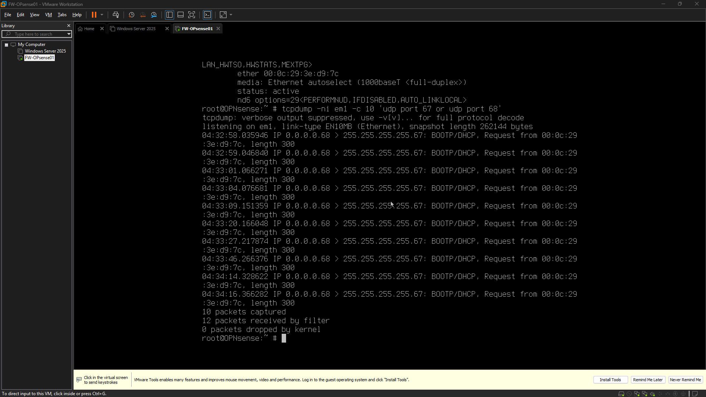

# Networking & Infrastructure Engineering Evidence Index

Screenshots below are copied only when referenced by an AutoDoc source log. Each transferred image is verified against its source bytes and linked back to that log.

## Transferred screenshots

<!-- autodoc:evidence-gallery:start -->
### OPNsense Live Boot

This screenshot captures the most important project evidence for the current phase, showing the main state, artifact, or operational view being reviewed. It highlights the key detail the viewer should notice in this stage of the project.
Source: [logs/2026-10-11.md](https://github.com/harkdev1/networking-infrastructure-engineering/blob/main/logs/2026-10-11.md). Image copied from the log reference and SHA-256 verified.

### VMware DHCP Investigation

This screenshot captures the most important project evidence for the current phase, showing the main state, artifact, or operational view being reviewed. It highlights the key detail the viewer should notice in this stage of the project.
Source: [logs/2026-10-12.md](https://github.com/harkdev1/networking-infrastructure-engineering/blob/main/logs/2026-10-12.md). Image copied from the log reference and SHA-256 verified.
<!-- autodoc:evidence-gallery:end -->
