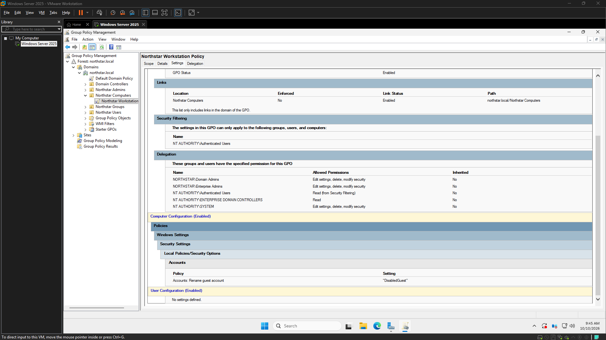
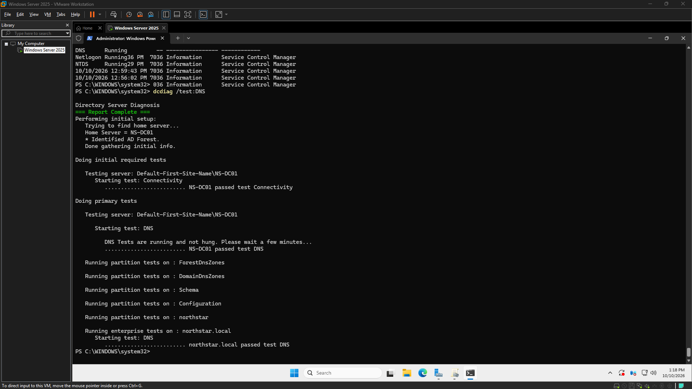
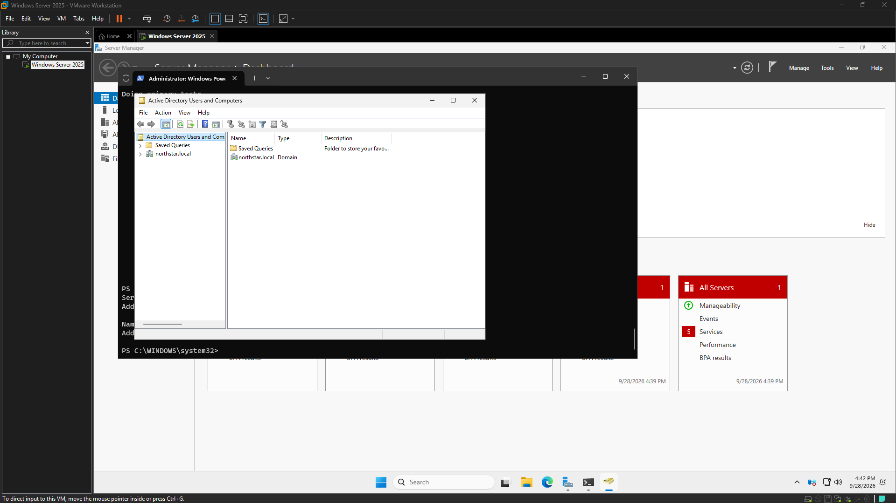
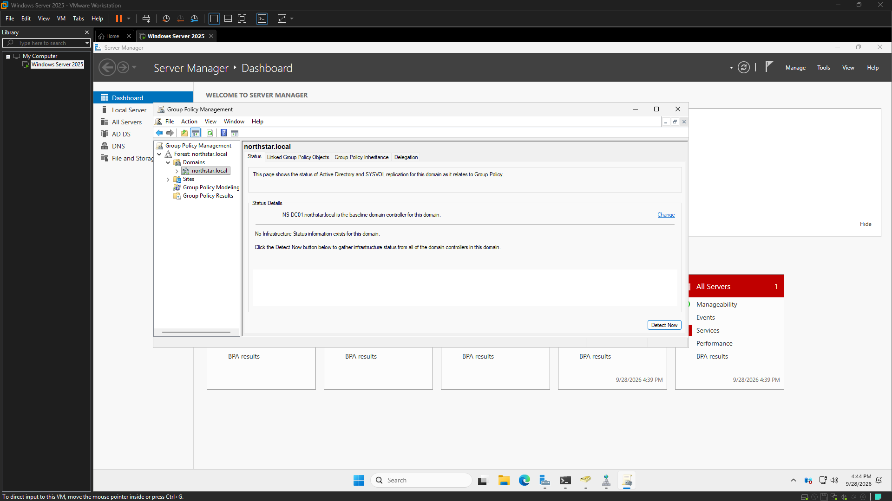

# Windows Helpdesk Lab

**Complete · v1.0** · [CyberOps archive](https://github.com/harkdev1/CyberOps-Sandbox/tree/main/projects/windows-helpdesk-lab)

A small-business-style Windows domain lab using the Northstar environment. The completed foundation covers NS-DC01, Active Directory and DNS, directory/group checks, and reusable PowerShell diagnostics.

The Northstar Workstation Policy is configured and linked, but its application to a domain-joined workstation is unverified. Account access, DNS/connectivity, and policy-behavior ticket exercises remain proposed future work, not completed incidents.

## Showcase

<!-- autodoc:project-showcase:start -->
**Status:** Complete (v1.0)
**CyberOps archive:** [https://github.com/harkdev1/CyberOps-Sandbox/tree/main/projects/windows-helpdesk-lab](https://github.com/harkdev1/CyberOps-Sandbox/tree/main/projects/windows-helpdesk-lab)

## What I built
A small-business-style Windows domain lab using the Northstar environment. The completed foundation covers NS-DC01, Active Directory and DNS, directory/group checks, and reusable PowerShell diagnostics.

The Northstar Workstation Policy is configured and linked, but its application to a domain-joined workstation is unverified. Account access, DNS/connectivity, and policy-behavior ticket exercises remain proposed future work, not completed incidents.

## Evidence gallery
### Northstar Workstation Policy Configured

Evidence copied from [logs/2026-10-10.md](https://github.com/harkdev1/CyberOps-Sandbox/blob/main/projects/windows-helpdesk-lab/logs/2026-10-10.md) and verified against the source image.

### Final DNS health check

Evidence copied from [logs/2026-10-10.md](https://github.com/harkdev1/CyberOps-Sandbox/blob/main/projects/windows-helpdesk-lab/logs/2026-10-10.md) and verified against the source image.

### Northstar Solutions Active Directory domain controller verified

Evidence copied from [logs/2026-09-28.md](https://github.com/harkdev1/CyberOps-Sandbox/blob/main/projects/windows-helpdesk-lab/logs/2026-09-28.md) and verified against the source image.

### Northstar Solutions Group Policy environment

Evidence copied from [logs/2026-09-28.md](https://github.com/harkdev1/CyberOps-Sandbox/blob/main/projects/windows-helpdesk-lab/logs/2026-09-28.md) and verified against the source image.

## Session highlights

### 2026-10-10 · 09:17 to 10:02
Recorded outcome: ✅ Yes. This session focused on practical Windows Server administration, encompassing Group Policy configuration, PowerShell-based system diagnostics, and the development of reusable tooling within a simulated corporate IT environment. Key deliverables included the creation and application of a workstation policy, specific account configuration, comprehensive system health checks using PowerShell, and thorough evidence-driven documentation.
[Open the archived AutoDoc log](https://github.com/harkdev1/CyberOps-Sandbox/blob/main/projects/windows-helpdesk-lab/logs/2026-10-10.md)

### 2026-10-05 · 05:06 to 05:24
Recorded outcome: ✅ Yes. This initial phase focused on establishing a foundational Active Directory environment for Northstar Solutions, simulating a corporate setup. The primary objective was to practically demonstrate core Windows Server and Active Directory administration tasks, ensuring documented evidence of the directory structure, account management, and security group organization.
[Open the archived AutoDoc log](https://github.com/harkdev1/CyberOps-Sandbox/blob/main/projects/windows-helpdesk-lab/logs/2026-10-05.md)

### 2026-09-28 · 15:38 to 16:46
Recorded outcome: ✅ Yes. The initial infrastructure for the Northstar Solutions Windows Server environment has been successfully deployed. This foundational work involved building the core domain controller and establishing essential network services, laying the groundwork for future administrative tasks and help-desk training scenarios.
[Open the archived AutoDoc log](https://github.com/harkdev1/CyberOps-Sandbox/blob/main/projects/windows-helpdesk-lab/logs/2026-09-28.md)

### 2026-09-23 · 01:28 to 01:35
Recorded outcome: ✅ Yes. The Windows Server operating system was successfully installed from an ISO image.
[Open the archived AutoDoc log](https://github.com/harkdev1/CyberOps-Sandbox/blob/main/projects/windows-helpdesk-lab/logs/2026-09-23.md)

## Current limitations and next steps
- Optional post-v1: verify the Northstar Workstation Policy on a domain-joined workstation.
- Optional post-v1: complete clearly labeled account-access, DNS/connectivity, and Group Policy practice tickets.
- Sanitize selected evidence before public portfolio use.

## Project files
- [Current project status](https://github.com/harkdev1/CyberOps-Sandbox/blob/main/projects/windows-helpdesk-lab/project-status.md)
- [Short project summary](https://github.com/harkdev1/CyberOps-Sandbox/blob/main/projects/windows-helpdesk-lab/docs/project-complete-short.md)
- [Full project history](https://github.com/harkdev1/CyberOps-Sandbox/blob/main/projects/windows-helpdesk-lab/docs/project-complete-long.md)
- [Evidence index](evidence-index.md)

---
Screenshots are copied only from image references present in AutoDoc logs. Review each image for private details before publishing.
Gallery folder: `projects/windows-helpdesk-lab/screenshots/`.
<!-- autodoc:project-showcase:end -->

AutoDoc adds approved images referenced by the project's logs and session highlights here after a successful `autodoc finish` or `autodoc project complete` sync.
