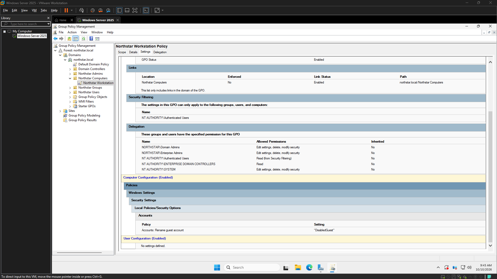
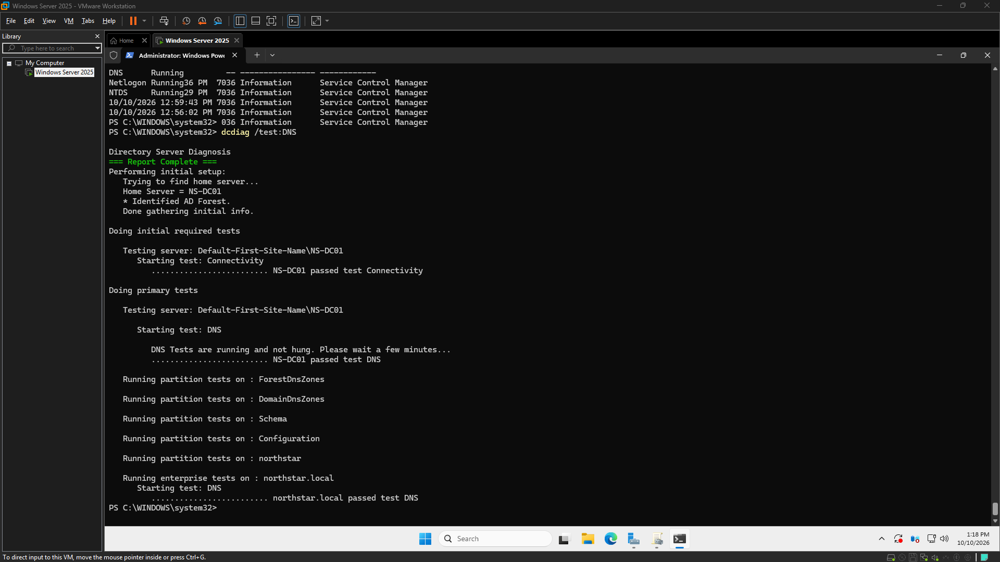
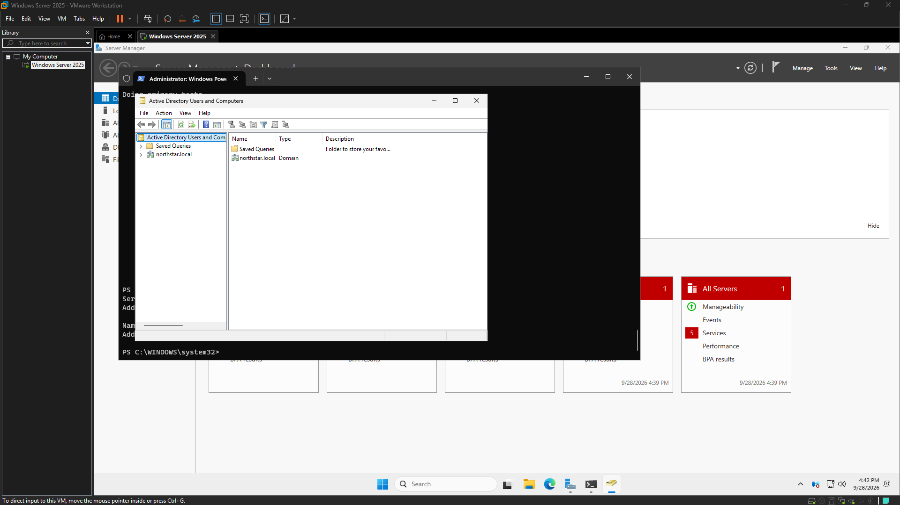
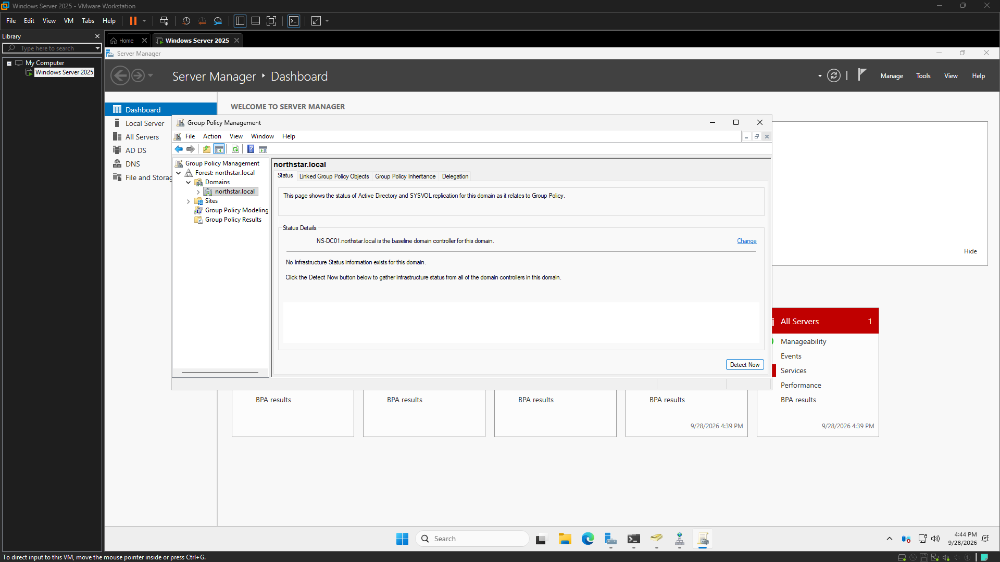

# Windows Helpdesk Lab Evidence

This index separates what the existing evidence demonstrates from what remains unverified. Screenshots displayed here are copied from image references in the source AutoDoc logs; the public log and project archive is in [CyberOps-Sandbox](https://github.com/harkdev1/CyberOps-Sandbox/tree/main/projects/windows-helpdesk-lab).

## What the evidence establishes

- **Northstar Workstation Policy:** The policy exists, is linked to the Northstar Computers OU, and includes the configured guest-account rename setting. This is configuration evidence only; application on a domain-joined workstation is not verified.
- **DNS health:** The final `dcdiag /test:DNS` screenshot displays passing DNS checks for the lab domain controller. This is a point-in-time result, not continuous monitoring or production assurance.
- **Active Directory foundation:** The session logs and domain-controller evidence document the Northstar AD DS setup and directory structure. Test-user names and membership details are intentionally not reproduced as public screenshot content.
- **PowerShell diagnostics:** The source logs record execution of `Get-HelpdeskSystemInfo.ps1`. Captures containing VM IPs, host identifiers, or detailed system output are withheld from the gallery.

## Archived session logs

- [Windows Server and AD/DNS foundation, 2026-09-28](https://github.com/harkdev1/CyberOps-Sandbox/blob/main/projects/windows-helpdesk-lab/logs/2026-09-28.md)
- [AD structure and groups, 2026-10-05](https://github.com/harkdev1/CyberOps-Sandbox/blob/main/projects/windows-helpdesk-lab/logs/2026-10-05.md)
- [GPO, script, and DNS validation, 2026-10-10](https://github.com/harkdev1/CyberOps-Sandbox/blob/main/projects/windows-helpdesk-lab/logs/2026-10-10.md)

## Transferred screenshots

<!-- autodoc:evidence-gallery:start -->
### Northstar Workstation Policy Configured

The source log labels this capture “Northstar Workstation Policy Configured.”
Source: [logs/2026-10-10.md](https://github.com/harkdev1/CyberOps-Sandbox/blob/main/projects/windows-helpdesk-lab/logs/2026-10-10.md). Image copied from the log reference and SHA-256 verified.

### Final DNS health check

The source log labels this capture “Final DNS health check.”
Source: [logs/2026-10-10.md](https://github.com/harkdev1/CyberOps-Sandbox/blob/main/projects/windows-helpdesk-lab/logs/2026-10-10.md). Image copied from the log reference and SHA-256 verified.

### Northstar Solutions Active Directory domain controller verified

The source log labels this capture “Northstar Solutions Active Directory domain controller verified.”
Source: [logs/2026-09-28.md](https://github.com/harkdev1/CyberOps-Sandbox/blob/main/projects/windows-helpdesk-lab/logs/2026-09-28.md). Image copied from the log reference and SHA-256 verified.

### Northstar Solutions Group Policy environment

The source log labels this capture “Northstar Solutions Group Policy environment.”
Source: [logs/2026-09-28.md](https://github.com/harkdev1/CyberOps-Sandbox/blob/main/projects/windows-helpdesk-lab/logs/2026-09-28.md). Image copied from the log reference and SHA-256 verified.
<!-- autodoc:evidence-gallery:end -->

AutoDoc refreshes this section from image links in the source logs. Each image is copied into this Roadmap folder and checked against the source bytes before it is committed.
