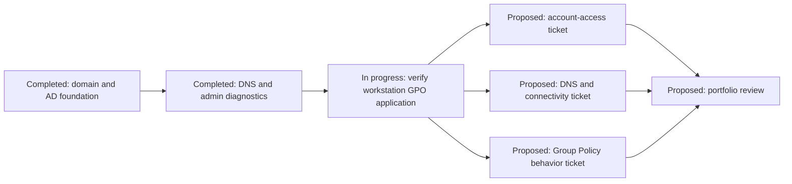

# Windows Helpdesk Lab Roadmap

**Current status:** In progress. The domain and administration foundation is documented; end-user ticket outcomes remain unproven.

## Phase map

## Phases

### 1. Lab foundation: completed

**Deliverables:** Windows Server environment for NS-DC01, `northstar.local` domain, AD DS and DNS services, Northstar organizational units, test accounts and groups.

**Evidence:** September 28 and October 5 session logs and the linked evidence inventory.

**Acceptance:** The source logs record the environment creation, AD structure, users/groups, and group memberships; existing screenshots show the AD tree and selected group membership. This confirms the documented lab foundation, not a production deployment.

### 2. Administration diagnostics: completed for the recorded checks

**Deliverables:** `Get-HelpdeskSystemInfo.ps1`, system/network/event-log reporting, DNS checks with `dcdiag`, and checks that NTDS, DNS, and Netlogon are running.

**Acceptance:** The October 10 log records successful execution and checks; the final DNS screenshot visibly reports the recorded `dcdiag /test:DNS` results passing. The script is a reporting aid, not an automated remediation tool.

### 3. Verify workstation policy application: in progress / deferred

**Deliverables:** A domain-joined workstation in the intended OU, a verified policy refresh/result, and sanitized evidence of the effective setting.

**Dependencies:** An available joined workstation or an explicitly scoped test workstation; correct OU membership and policy scope.

**Acceptance criteria:**
- Confirm the workstation is joined to `northstar.local` and resides in Northstar Computers.
- Run and retain `gpresult` or Resultant Set of Policy output for the computer.
- Confirm the Northstar Workstation Policy is applied and the intended guest-account rename setting is effective.
- If it is not applied, record the actual blocker and diagnose scope/filtering rather than marking the policy successful.
- Remove internal addresses, usernames, and other unnecessary machine details from portfolio evidence.

The GPO itself exists, is enabled, and is linked to Northstar Computers. Workstation-level application remains unverified.

### 4. Simulated account-access ticket: proposed

**Scenario:** A test user reports inability to access a domain resource. This is a future controlled exercise, not a historical incident.

**Dependencies:** Existing test account, documented safe reset procedure, and a target resource or sign-in test. Never record passwords or reusable secrets.

**Acceptance criteria:** Record the reported symptom; check account state and group membership; test the relevant authentication/resource path; apply only an authorized lab change; verify access; capture sanitized before/after evidence and a resolution note.

### 5. Simulated DNS/connectivity ticket: proposed

**Scenario:** A test workstation cannot resolve or reach a named lab resource. No such end-to-end support ticket is claimed completed yet.

**Dependencies:** A domain-joined workstation and a controlled test name/service with known expected behavior.

**Acceptance criteria:** Capture the symptom; check interface, gateway, DNS client settings, name resolution, and relevant server-side DNS health; distinguish DNS failure from reachability or service failure; document observed cause and verification. Do not infer causation from temporal correlation alone.

### 6. Simulated Group Policy ticket: proposed

**Scenario:** A user reports that a workstation policy is missing or has not taken effect.

**Dependencies:** Phase 3 policy-application verification and a reproducible client state.

**Acceptance criteria:** Check OU placement, GPO link and enabled state, security filtering, policy refresh, and resultant policy; document whether the setting applied; verify the user-visible or system-level effect; capture sanitized evidence. Do not label configuration as effective before client verification.

### 7. Portfolio review: proposed

**Deliverables:** Three reviewed ticket write-ups, a concise architecture explanation, sanitized screenshots, clear limitations, and repeatable setup/validation notes.

**Acceptance:** A reviewer can follow the symptom, investigation, evidence, decision, change, and verification for each scenario without relying on unsupported claims or private data.

## Priority order

1. Verify GPO application on a joined workstation; this closes the most important currently documented verification gap.
2. Complete one controlled account-access ticket end to end.
3. Complete one controlled DNS/connectivity ticket end to end.
4. Complete one controlled Group Policy behavior ticket end to end.
5. Review and sanitize portfolio evidence and then update the narrative from actual outcomes.
