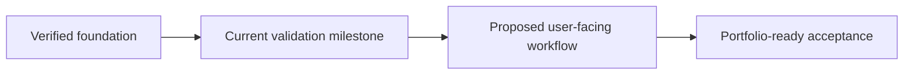

# [Project Name]

> **Status:** [In progress | Complete | Paused]
> **Last reviewed:** [YYYY-MM-DD]
> **Source repository:** [relative path or verified URL]
> **Recommended next milestone:** [one evidence-backed action]

## Overview

### Purpose and audience
[What problem does the project address, and who is it for?]

### Current state
[Describe the actual state, not the original plan. Note uncertainty explicitly.]

## Project story
[Concise, technically honest narrative suitable for a portfolio or project handoff.]

## Accomplishments and milestone history

| Date | Status | Milestone | Evidence and verification |
|---|---|---|---|
| YYYY-MM-DD | Completed / In progress / Deferred / Proposed | [Milestone] | [Source links; what they prove] |

## Technical implementation summary

- **Architecture and environment:** [verified facts]
- **Components and configuration:** [source-linked implementation]
- **Validation performed:** [commands, results, and limits]
- **Not yet verified:** [explicit gaps]

## Phase-based roadmap

| Phase | Status | Deliverables | Dependencies | Acceptance criteria |
|---|---|---|---|---|
| Foundation | [status] | [deliverables] | [dependencies] | [observable pass conditions] |

## Evidence inventory

| Evidence | Source location | What it demonstrates | Limitations or privacy review |
|---|---|---|---|
| [log, screenshot, script, test] | [relative link] | [observed content/result] | [redaction or interpretation caveat] |

## Current limitations and deferred work

- [Unverified behavior, constraint, or explicit deferral]

## Prioritized next steps

1. **[Highest value]** [Action and measurable acceptance criteria]
2. [Next action]
3. [Later or optional work]

## Update notes

- [YYYY-MM-DD] [What changed in this Roadmap project folder and why]
